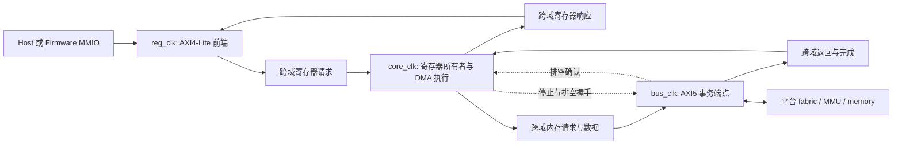

# PDMA RTL 架构设计输入

状态：编码前设计草案，2026-10-28。本文区分已经确认的目标、已有体系结构约定和
尚待评审的微架构选择；不宣称 RTL 已实现或已经满足时序。规范入口仍是
[system specification](../../model/modeling/docs/spec.md)。
涉及寄存器提交协议的变化，必须先同步 contract、Host/Firmware 和 model 测试，不能只改 RTL。

本轮具体草案：

| 文档 | 内容 |
| --- | --- |
| [寄存器接口](register-interface.md) | 32/64 位单 leaf 访问、提交、权限和跨域返回 |
| [内存接口](memory-interface.md) | AXI5 事务责任、ID、atomic、RESP/USER 和可见性 |
| [共享数据通路](datapath.md) | 阶段与状态归属、保留窗口、吞吐预算和等价性问题 |
| [Reset 与 CDC](reset-cdc.md) | 关闭/排空协议、跨域责任、通知和 timer |

这是同一套设计的不同视角，不新增 Rust runtime、通用 pipeline 组合子或软件命令。

## 已确认的设计输入

| 项目 | 本轮决定 |
| --- | --- |
| 设计语言和工具 | 参考 pcie_modeling 的 Veryl、原生测试、VCS/UVM/VIP、DC、VC SpyGlass 流程；本阶段视为可用，不开展工具仓库拆分或重新验证 flow |
| 工具版本 | PDMA 在 tools/rtl-flow 独立维护固定 Veryl 源码版本、有序补丁和安装入口，以 pcie_modeling 已验证快照为起点；后续再统一共享仓库，不自动跟随外部更新 |
| 内存接口 | AXI5 master；需要明确选择 atomic 支持及相关事务属性 |
| 寄存器接口 | AXI4-Lite slave，数据位宽在实例化时选择 32 或 64 位 |
| 时钟 | 寄存器 slave、core、bus master 三个域；没有相位关系保证时按异步跨域设计 |
| 物理复位 | 三个域均异步置位、分别相对本域时钟同步释放；不要求三个域在同一时刻释放 |
| 物理目标 | 22nm、500MHz 暂定；具体库、PVT、三域工作频率和 IO 预算仍需落实，不能由工艺节点直接推导 timing PASS |
| 内存数据位宽 | 实例参数，按 AMBA 合法档位约束；不能把数据位宽误当作地址、descriptor 或 atomic operand 的位宽 |
| channel/context | 实例参数；数量影响真实存储和访问结构，不只是 generate 次数 |
| 吞吐 | 无不合理的内部吞吐损失；在声明的工作条件下，zero-delay 外部系统不能被内部周期性空泡限速 |

2026-10-29 用户明确：**先只做 DMA RTL，收敛后再考虑 CPU、外围组件和子系统**。
当前范围是 DMA 自有寄存器、channel、共享执行、内存端口、通知及 reset/维护边界。
现有 DMA 内部 Drain/Abort 语义保留，用 testbench 驱动它的控制接口；不实现外围的
ContextRequest MMIO、context table、Function/window 路由、PF control channel 或 CPU。

保留后续 direct DMA 和 firmware-managed 集成的边界。后者的 Function/window/context 管理
仍在 DMA 外围，生命周期策略仍由 firmware 承担；不把 Function/PASID 表塞回 DMA core。
当前不增加 PCIe、MMU、逻辑 channel 超售、NPU 或 firmware 失效后的完整设备救援机制。

## 本阶段 DMA top 的边界

接口名称尚未冻结，首阶段按下列实际责任定义端口，不先实例化一个完整子系统：

| DMA 边界 | 当前需要表达的内容 | 明确留在外部的部分 |
| --- | --- | --- |
| 寄存器访问 | 一个 32/64 位 AXI4-Lite slave，覆盖 DMA discovery/admin/channel map | Function/PF/VF 权限窗口、PF control 与 boot 寄存器 |
| 内存访问 | 一个 AXI5 master；请求保留 channel 与完整 ContextId，响应保留错误原因 | selector 到 Function/PASID/ch_tag 的映射、MMU、内存实体与 CPU cache 协调 |
| Context 维护控制 | 完整 ContextId、Drain/Abort、受理/忙状态、结果及失败 channel 集合 | ContextRequest MMIO 编码、context valid/owner 表、Destroy 策略与 firmware 请求队列 |
| 通知 | channel notification pending/accept 和独立 DMA-wide fatal pending/accept | 中断控制器、CPU ISR、Function 路由与 PCIe MSI |
| 时间 | core 域一致的 64 位外部样本；无 timer 配置下 Timestamp 按既有 Unsupported 语义 | timer 实体、计时单位及异步源的快照适配 |
| 时钟/复位 | reg/core/bus 三域及各域同步释放；软件 reset 仍走责任排空 | 平台冷复位协调、电源管理与任意单域热复位恢复 |

维护控制是 DMA 内已有行为的硬件接口，不新增 Host/VF 可写的维护寄存器，也不是
firmware 的命令队列。首版只需一个在途维护操作，结果交接与 reset 的独立受理必须
明确；外围未来把它接到自己的寄存器，而不是让 DMA 解析 PF control descriptor。
本阶段的验证端直接驱动该接口，检查 producer frontier、引用保留和 reset 打断维护。

DMA 输出的 channel/context selector 需要稳定地随 AR/AW 交付。它们不是最终的
MMU 身份；后续外围可做映射，而普通直连适配可以按其平台约定使用或忽略 selector。
因此没有必要现在为 DMA 添加 Function/PASID 表、预留 control context slot 或 K 参数。
本阶段的结构参数是 channel 数、总线宽度/ID/缓冲容量及既有能力开关；最终取值需验证。

testbench 承担寄存器 driver、memory responder、fault/timer 注入和通知接收，使用
独立期望检查。它不实现另一套 DMA engine，也不为了驱动这些接口先造 CPU/firmware。

## 三个时钟域的职责

以下是建议的状态归属，尚未冻结模块端口名称和 FIFO 深度。

| 所有者 | 持久状态与责任 | 不承担的责任 |
| --- | --- | --- |
| reg_clk 前端 | 独立接收 AW/W/AR、请求缓冲、响应缓冲、访问尺寸与字节使能转换 | 不另存一套可被软件直接读到的 channel 状态，不自行判定 reset 完成 |
| core_clk 各硬件对象 | channel/ring/IRQ 状态、接受任务、执行进度、维护状态；外围自己的 window/context 寄存器 | 不把一次跨域请求入队视为外部访问完成 |
| bus_clk 读端点 | AR 提交、ID 与返回匹配、R beat 接收、读完成及错误 | 不决定命令是否可以退休或 context 是否可以销毁 |
| bus_clk 写端点 | AW/W 关联、数据保持、B 返回、写完成及错误 | 不把 AW 或 W 接受视为写入已完成 |
| bus_clk atomic 端点 | atomic 操作编码、返回数据与写响应的共同生命周期 | 不把没有软件 old-value 输出解释成不需要接收 R 响应 |
| 跨域通道 | 有界数据 custody、credit、关闭边界与确认 | 不拥有 channel 分配或软件恢复策略 |

建议真实寄存器状态与所属对象留在 core 域，reg 域只作总线适配。写响应在 core
接受该操作后返回；reset 写的接受和 reset 完成是两件事。读响应是 core 域形成的
一致快照，而不是逐位同步一个正在变化的多位寄存器。控制请求的推进不依赖数据流水的 READY。

软件 channel/DMA reset 是逻辑清理协议，不能通过直接复位跨域 FIFO 来丢弃旧事务。
三个域均采用异步复位、相对本域时钟同步释放。跨域通路必须在两端初始化完成后才
允许传递有效请求，不能仅凭本端复位已释放就使用对端状态。
异步置位/同步释放定义的是复位电气时序，不自动意味着可以在有 outstanding 时任意
独立复位某一域。冷复位的系统协调、独立停钟和恢复仍需定义平台约束；任何尚有义务
的域停钟，都不能用 timeout 伪造成功排空。

## 寄存器 32/64 位共同协议

具体访问矩阵、ContextRequest 编码建议、跨域提交路径和实施范围见
[寄存器接口设计草案](register-interface.md)。该文档同样待评审，尚未修改现有 contract。

DMA 自身的动作寄存器是 32 位，64 位的是 ring base 配置。外围 `ContextRequest`
虽然目前要求完整 64 位写，但不属于本阶段 DMA map；其格式改版留到外围阶段，
不再作为 DMA 编码前置条件。

具体草案建议 ring 地址分段写后由 channel enable 发布。64 位端口仍一次选中一个 leaf，不合并相邻
寄存器；平台桥接必须保留低地址位和 byte lane，不能无条件套用任意宽度转换器。
这些建议已有具体矩阵和错误规则，但仍未修改当前 contract；不宣称已支持两种物理接口。

## 命令、流水与资源归属

逻辑数据通路仍是 channel 提供候选、仲裁选中一个任务、Fetch/恢复、opcode 执行、退休。
每个 channel 是硬件状态所有者；各级通过数据和显式状态交互，不让后级调用前级推进。
一条健康命令内部持续发射数据工作，不因一个 chunk 完成就重走候选、仲裁和 Fetch。

| 资源 | 所有者 | 生命周期终点 |
| --- | --- | --- |
| 候选与保持的 grant | 仲裁/接收边界 | 被下一级真正接受或因生命周期变化撤销；不是新命令的执行完成 |
| 原始命令与 context 引用 | channel | 最终成功、停止错误的清理完成，或安全取消；park/wait 不释放 |
| SG/Linear 游标与已完成进度 | channel 执行状态 | 命令退休或 reset/Abort 清理 |
| 正常数据流缓冲 | 对应 read/transform/write 段 | 下一所有者接受；不能同时有两份可独立修改的权威状态 |
| 缺页保留数据 | channel 的保留资源 | 写成功或安全取消；写故障恢复不能重新读取并变换源数据 |
| 已接受的总线事务 | 对应 bus 读/写/atomic 端点 | 所需返回全部消费，错误和结果已交付，ID 才可复用 |
| 错误事件发布 | channel 的事件生产接口 | producer 只在成功发布后推进；失败走既有 fatal 语义 |

命令接受必须是可指出的本地状态提交点：建立命令/context 归属与推进 consumer 之间
不能有对维护逻辑可见的空隙。候选、预取、消费 descriptor、开始执行和最终完成需要
明确区分。Abort 与该接受点有确定先后；同周期事件优先级必须写成 next-state 规则。

本轮仍是一套共享执行能力，不因增加 channel 数就复制完整执行单元。读、变换、写可
流水重叠；这与是否复制 command engine 是不同问题。寄存器表、RAM 端口、credit 和
仲裁必须围绕实际访问需求设计，不能照着 Rust 的 Vec/struct 数量直接例化。

## AXI5 atomic 与排序

AXI5 是协议选择，端到端 atomic 支持仍需由配置和平台保证。PDMA 的 atomic32/64
发现能力不能仅凭总线名称置位；请求、操作数、返回和错误都必须完整处理。

Arm IHI0022H 的 E1.1 区分仅写响应的 AtomicStore，以及带旧值读取返回的
AtomicLoad/Swap/Compare。后者还有 B 响应；总线资源不能因先收到某一种响应就提前释放。
Compare 的结果需要检查返回旧值；Compare 的数据组织也不同于普通写事务。
依据：[AXI/ACE specification](https://developer.arm.com/-/media/Arm%20Developer%20Community/PDF/IHI0022H_amba_axi_protocol_spec.pdf)。

建议映射审查：

| PDMA 操作 | AXI5 实现方向 | 必须保留的语义 |
| --- | --- | --- |
| Add/Subtract、And/Or/Xor | 合适的原生 atomic 操作；Subtract/And 可进行位宽内操作数变换 | 环绕算术、操作位宽和规定的 memory order |
| Exchange | AtomicSwap | 即便软件不接收 old value，也必须排空协议返回 |
| CompareExchange | AtomicCompare | 不匹配不是访问错误；不得伪造成功更新 |
| SEM Signal/Wait | 读值、条件检查和 CAS 重试的有界执行 | overflow 不修改；仅 count>0 才消费；竞争失败释放 grant 后重试 |
| Wait/Fence | 普通读写配合规定的可见性和排序 | Wait 成功是 acquire；Fence 是同 channel 的 release，不是全设备 barrier |

上表不冻结 AWATOP 编码或 burst 波形；按选定的协议 issue、VIP 配置和操作位宽完成
合法性矩阵。普通 atomic Add 不能直接替代有 overflow 拒绝语义的 SEM Signal。
Acquire/release 还需要内部发射/退休约束及平台可见性，不能只映射成一个未经验证的 USER 位。

## reset、维护和故障的跨域证明

**Reset 关闭边界。** core 停止该 scope 的新命令及新内存工作，在独立控制通路通知
bus 域关闭。关闭确认必须覆盖跨域通道中尚不可见的旧请求、已保持的 AXI offer、读写
outstanding、未交付的完成和保留任务。可以用有界 credit 或发射水位证明覆盖，但不能
只把同步过来的 FIFO empty 与一个 outstanding 计数为零相与。

已经承诺的总线传输按协议完成；不因 reset 撤回保持中的 VALID、丢弃 W 数据或复用 ID。
尚未承诺的旧工作可以取消，但必须归还实际占用的资源。core 只有在所有受影响端点和
保留状态完成清理后才能清 busy。peer channel 状态保留；不能用全局清空 FIFO 实现单 channel reset。

**Context 维护。** producer frontier、consumer 到达 frontier、accepted task 清零和
bus 事务排空是不同事实。普通 Wait 可令 Drain 一直 pending；Reset 可以中断其目标，
但不能清掉清理义务。Destroy 仍由 firmware 在清理成功后撤销 valid。

**PageFault 响应接口。** 采用用户提出的 RRESP/BRESP 错误响应加 RUSER/BUSER 原因码
方向；原因编码由本项目定义，平台适配层负责转换、保留，具体位宽和值尚未冻结。
这属于 PDMA 的 AXI 集成约定，不是 AXI 标准定义的 PageFault 编码。USER_RESP_WIDTH
对应的响应信息由 BUSER 和 RUSER 低位承载；读 burst 的原因信息建议各 beat 保持一致，
便于互连宽度转换。依据上述 AXI 规范 A8.3；读写错误响应仍须遵守正常协议收尾义务。

建议原因至少区分普通访问错误与可恢复 PageFault。只有明确的错误响应加 PageFault
原因才进入缺页分类；USER 缺失、未知编码或普通 SLVERR/DECERR 均不能自动解释为缺页。
最终停顿/错误/fatal 行为仍由访问用途决定：payload 按现有合同保留并等待 resume，
descriptor、SG 和 event 等 metadata 不因携带同一原因而自动获得可恢复语义。

可重试标记还必须包含明确的系统承诺：标记为 PageFault 的写事务没有已生效的目标
写入，atomic 没有已生效的更新；否则单一原因码不足以支持安全重试。读 burst 须定义
错误数据的丢弃边界并接收完规定的返回；写 burst 仍须完成 W/B 协议收尾。返回 R/B
两路的 atomic 必须一致描述同一操作的结果，并收齐所需返回后才能释放事务资源。
这些是待落实的集成约束，不能从 AXI 的 error 响应本身推导“没有副作用”。

RID/BID 与本地事务表负责关联 DMA 请求；fault report 的 ch_tag 则仍由平台携带并
保持到软件处理结束。RUSER/BUSER 不取代平台/MMU 向软件报告和修页的路径。透明
ATS+PRI 保持事务的配置不向 DMA 暴露这种终止，仍属于另一种平台适配方式。

**多 outstanding 下的保留状态。** fault 后必须停止新发射并交代已有访问的结果。
如果允许后发的写先完成，就不能只保存一个 committed-prefix 和单个 scratch 后全部重放。
需要记录并跳过这些已提交访问，或给出能够排除这种情况的真实发射/提交结构。
这是编码前必须完成的 transaction-window 设计，不以“丢弃后续流水”代替。
恢复只重试未完成工作；已经消费的 semaphore、atomic 更新、Timestamp 样本均不能重做。
重叠访问已经明确由软件负责：不检查、不拒绝，也不保证特定覆盖顺序；同 channel
命令顺序和安全重试仍保证。永久错误的 prefix 已提出“报告时已确认连续前缀”的快照
规则，不作为重试起点；仍需同步规范。具体影响和推导见 [datapath](datapath.md)。

## 吞吐要求与容量评估

用外部端口能力定义参考值，不能把内部设计瓶颈放进分母后宣称达到峰值。
令 R/W 为外部可用读/写字节率，M 为若两者共享物理 memory 时的聚合字节率：

`T_copy_reference = min(R, W, M / 2)`；独立读写后端没有共同 M 限制时去掉该项。

core 数据通路和 CDC 稳态服务率必须达到这个参考值，或明确给出受支持频率比的限制。
三个域存在同步延迟，不意味着必须每次等 credit 往返才发下一 beat。
“zero-delay”指外部持续接受、无额外处理等待；不假设违反协议的组合环路或零 CDC 延迟。

验收至少分别测：

- 长、对齐 Linear Copy 的启动、稳态、收尾；足够供给后是否持续接收 R 和发送 W。
- back-to-back burst、边界切分、非对齐头尾和独立 src/dst SG 边界。
- 小命令串的 descriptor/调度开销，不能用长传输峰值掩盖逐命令空泡。
- 多 channel 争用、独立 read/write backpressure、错频/错相、park/resume 和 reset。
- FIFO 占用、请求/返回空泡的原因、每单位时间有效 payload 字节数，而不只统计总线 beat 数。

buffer 和 outstanding 深度应从端口往返延迟、时钟比、burst 大小和完整响应义务推导。
内存请求窗口满时反压是合法的；无外部阻塞时因内部控制反复启动导致的固定空泡不应被接受。
若要求所有频率比都不成为瓶颈，则资源无有限上界，因此必须明确工作频率区间。

## 可配置规模与参考案例

AXI 数据总线宽度具有协议限定档位；atomic 操作数仍按 PDMA 的 32/64 位能力处理。
AMD AXI MCDMA 展示了共享 DMA 资源下的多 channel 配置，MM2S/S2MM 各可到 16 个 channel；
这是结构和测试规模的参考，不代表 PDMA 的上下限已经确定。
来源：[PG288 Product Specification](https://docs.amd.com/r/1.1-English/pg288-axi-mcdma/Product-Specification)。

Intel DSA 将 WQ、engine 和 group 区分配置，并通过能力提供最大数量；不能把 WQ 数
直接解释为执行单元数，也不能把 PASID 标识空间大小当作物理 context table 深度。
来源：[DSA User Guide，3.2.5](https://cdrdv2-public.intel.com/759709/353216-004-intel-data-streaming-accelerator-user-guide.pdf)。

建议先用下列点作资源/验证扫描，**它们不是已承诺的最大规格**：

| 维度 | 设计与验证候选 |
| --- | --- |
| channel 数 C | 1、2、3、8、16；3 覆盖非二次幂索引/仲裁，后续依面积时序决定更大规模 |
| context 数 K | 外围阶段再评估；本阶段 DMA 只保留 32 位 selector 和已有维护语义，不实例化 K 项表 |
| master data width | 按协议档位建参数合法性矩阵，优先测窄、中、宽代表点，再覆盖承诺的全部档位 |
| slave data width | 32 与 64，执行相同的软件场景和提交语义检查 |
| clocks | 相同频率不同相位、非整数比、core 较慢、bus 较慢；物理停钟另有恢复协议 |

本阶段预算必须分别列出：C 份 channel/任务保留状态，读/写/atomic
outstanding，跨域 FIFO，以及故障后仍须保留的数据。单块 scratch 是否可服务全部
parked channel 取决于实际分配与容量保证，不能由模型里的一个常量得出结论。
500MHz 的评估也必须覆盖大 C 的选择网络和宽数据路径；外围的 K 项授权表留到后续。
参数能展开不等于
该规模已获得功能或时序支持。generic RAM 的综合结果不能冒称已经绑定 SRAM 宏的 PPA。

## 验证衔接与编码前剩余决定

Rust model 是可观察行为参考，继续保留硬件、firmware、Host 和 platform 的责任边界。
局部 ready/valid、CDC 队列、仲裁和事务跟踪用原生 RTL 测试；组合验证使用 VIP 的
transaction/monitor 观察，与输入驱动的 memory/事件预期比较。不能另造总线执行器替代
VIP，也不能用 DUT 自己报告的值生成同一项检查的 expected。

跨 channel 的合法交织、周期和 burst 划分不要求逐拍等同于 Rust step。
无竞争场景比较最终数据与系统状态；有竞争场景检查明确的 happens-before、身份和
允许结果，不把某条模型调度轨迹冒称唯一结果。总线握手、所有返回排空、CDC/RDC 和
物理约束另有 RTL 验证，不能由 model PASS 推导。

当前设计状态与实现门槛：

| 项目 | 已形成的草案 | 仍需落实的门槛 |
| --- | --- | --- |
| 寄存器 | DMA map 的 lane/strobe、配置发布和错误映射 | 桥接兼容性与 DMA owner 行为验证；外围格式不阻塞本阶段 |
| AXI5 | slot 责任、ID 生命周期、原子映射、reason 编码 | 精确协议 profile、参数组合、VIP 检查与返回异常测试 |
| Reset/CDC | 请求接收前计债、Close/Drain/Open、通知/timer 归属 | 实际 CDC/RDC 结构、初始化和同拍断言 |
| 数据通路 | owner/阶段接口、任务和事务分层、软件重叠义务及 prefix 快照建议 | 正式记录错误进度保证并验证实际返回交错 |
| 性能/PPA | 外部参考吞吐、容量下界、覆盖维度 | 具体 clock ratio、资源档位、真实库/PVT 和测量结果 |

不要把已经形成设计建议写成已经完成实现验证。尚未闭合的数据通路优化，不阻塞
其它已明确对象的独立设计，但也不能据此宣称可以直接冻结完整高吞吐执行 engine。

建议先实现的验证切片仍包含两个 channel 共享执行能力，贯通 Copy、Fence/Trap 和
reset；这是验证顺序建议，不删除其余 DMA 命令。managed 模式仅保留接口边界，
CPU/外围/子系统实现与资格验证在 DMA 收敛后另行开展。
目录与原生 Veryl manifest 已建立，见 [RTL 入口](../../rtl/README.md)。尚无 RTL
设计源文件或可执行测试；本阶段没有修改 contract/model，也没有改动 pcie_modeling。
