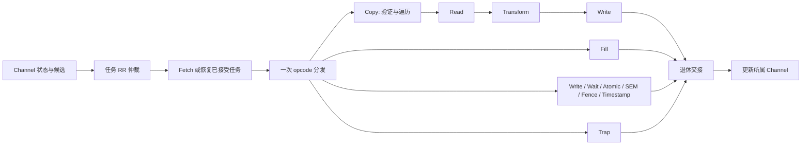

# 共享执行流水与资源设计草案

状态：尚未编码。本文把 [architecture](architecture.md) 的原则展开到状态所有者、
数据交接和吞吐预算。它不是 Rust 模块的逐一翻译，也不引入逻辑 channel 超售。
2026-10-29 明确首阶段仅实现 DMA；CPU、外围组件及完整子系统留到 DMA 收敛以后。
总线责任见 [memory-interface](memory-interface.md)，跨域关闭见 [reset-cdc](reset-cdc.md)。

## 一条数据通路

各 branch 是 opcode 本身的执行结构，不是另一层按 opcode 再解释一次的 controller。
Copy 内部可以长期推进 read/transform/write；只有命令结束、普通等待或 fault 退出才
释放相应执行 residency，不把每个 chunk 完成变成整个外围流水结束。
图中的状态更新反馈不是“后级调用前级 step”。实现用寄存器、握手和清晰的输入输出。

channel 是持久硬件状态对象，不是一个复制了完整 engine 的 pipeline。候选是对任务的
非拥有观察；仲裁选中任务后 Fetch 再检查其头指针/状态是否仍适用，不能把失效候选
悄悄换成同 channel 的另一个任务。只有实际接受工作才推进 RR cursor，空扫描不转动。

## 状态、接口和端口归属

| 所有者 | 保存的状态 | 输出/修改边界 |
| --- | --- | --- |
| 每个 channel | 配置/游标/IRQ/fatal/fault；已接受原始 command 和 context 引用；遍历/保留数据身份 | 提供候选、寄存器访问、event push、暂停/恢复/退休 |
| 仲裁 | RR cursor、被下游背压的候选 | 提交一个具体任务，不推进候选生产者 |
| Fetch | 当前 descriptor 的读责任、完整 decode 缓冲 | Fresh command 或 retained command；成功接受时安装账本并推进 consumer |
| Copy 遍历 | 验证/执行游标、当前 src/dst 范围和剩余长度 | 一个明确地址、长度、selector 的数据工作项 |
| Read/Transform/Write | 当级持有的数据和下一级握手状态 | 传递 buffer 使用权与结果；不重新验证整个 command |
| scalar/atomic branch | 当前 word 操作及已完成效果、Timestamp 样本 | 一次访问结果、普通等待、park 或 terminal completion |
| bus endpoint | AXI slot、ID、外部请求与返回责任 | 每个内部请求一个 terminal receipt |
| 退休边界 | 已退出执行路径的状态与责任是否结清 | terminal 清 accepted；wait/park 保留 accepted |

跨对象持久状态属于 owner，局部状态属于消费它的阶段；不把全部状态复制到一个
“每条命令上下文”再让各模块维护自己的镜像。仲裁后的工作项必须带实际 channel 身份，
共享阶段访问相应资源，不能固定绑定某个 channel 或执行其它 channel 的方法。

accepted task 的 context 引用与 command consumer 推进在同一个可线性化边界完成。
无效 descriptor 不推进 consumer，走 CommandRead fatal；已成功 decode 后发现非法
操作/范围则按现有 command error 路径处理。ring context 的存活约束独立于某一条
command 的 payload 引用，不能在 enable=0 时就假定 ring 不再绑定 context。

context 的 owner/attributes/valid 表由未来外围 hw-components 拥有，本阶段不实现。
DMA 保存 selector 和已有任务引用，不加入 K 项授权表，不缩减 ContextId 位宽。
DMA 内部的 context Drain/Abort、producer frontier、parked 引用和 reset 交互仍属
本体行为，由 testbench 经 DMA 维护控制边界直接驱动；外围 MMIO 编码和固件调度延后。

## Copy/Fill 的工作项与保留窗口

先验证选定的两端范围，再进行 payload 效果；零长度不访问 SG 或 payload。验证只走
选定范围，不扫描不使用的前后段，也不缓存整个 SG list。验证后 execution traversal
从选定起点推进；软件按现有合同保持 metadata 稳定。必要的重复 metadata 读取是
现有“访问前完整验证”语义的成本，不能为优化启动时间擅自移除。

工作项包含 owner、两端地址/selector、字节长度、顺序位置和 buffer handle。
其长度受 src/dst 段边界、地址边界和已预留 buffer 限制。Fill 只有目标、pattern 和
pattern phase，不做虚假的 source read；跨工作项时 pattern 相位必须连续。

候选的有界窗口记录每个工作项：

- 源读取是否完成及保留数据是否有效；transform 是否已完成。
- 目的写是否尚未发射、已 offer、成功或 fault；对应外部责任是否结束。
- 逻辑顺序与两端游标；哪些字节可以计入连续 committed prefix。

这个窗口解决多个物理事务的账目，**本身不授权预读、跨越依赖或乱序产生效果**。
成功写才能推进 committed prefix；仅拿到某个较晚事务的 B 不代表其前驱完成。
读取成功、写入缺页时保留原数据及 transform 结果，直到重试成功或 cleanup。

每个 channel 都必须有可兑现的 parked 存储份额，或者在接收/发射前预留足够资源。
不能让第一个 faulted channel 占满唯一的 scratch 后，仍宣称其它 channel 可以运行。
第一版资源评估先比较 per-channel 固定窗口与有保底 credit 的共享池，优先采用能
直接证明容量的结构；共享池省面积之前必须证明不会产生 fault-induced deadlock。
窗口有 W 个槽、每槽最多 P 字节时，固定份额的 payload 容量为 C*W*P，另加元数据；
这个公式不是要求马上选择某个 W/P，更不是按 Rust Vec 分配一块无限存储。

## 停顿、缺页、错误和同 channel 顺序

健康工作背压上游，保留当前 command。普通 Wait/SEM 未满足时，只保留 accepted 状态
并释放 grant，候选逻辑在后续轮次重试；same-channel successor 仍然不能绕过它。
没有超时成功、等待 event slot 或由 firmware 代为执行这些 word 命令的分支。

遇到 PageFault 停止目标任务新发射，已承诺的事务仍要排空并保存结果。只有工作被
完整转移到 channel 保留资源后才能释放共享 residency；FAULT_STATUS.faulted 公布时
必须已具备安全恢复的状态。平台报告可能先到，软件按原合同等 faulted 后再 resume。
peer 是否能在目标事务收尾期间就运行，取决于是否已完成全部局部 owner 交接；不能
只清一个全局 active 位就抛弃尚在途的数据。可用资源和外部返回正常时，peer 必须推进。

永久错误先 latch stop，再由 channel 的 event producer 发一次 error event；没有
独立的成功事件 stage。event写成功才发布 producer；满/损坏/写失败转 fatal，不作为
普通 admission 反压。退休等 resident 和 bus 责任都结束；IRQ 出现不是提前释放许可。

默认不重叠同 channel 不同 command 的内存效果。这直接保持 Wait/Fence 和成功顺序，
也是第一版不需要推测依赖图的原因。可预取 descriptor 的设计也必须保留未接受状态，
不能推进 consumer、安装错误的引用或触发 payload；预取不是当前必选实现。

## 行为边界及其收敛

### 已明确：重叠由软件负责，不保证 model 的访问顺序

当前 [overlapping_segments_follow_execution_order](../../model/modeling/crates/dma/tests/scatter_gather.rs)
展示了模型的一种执行结果：初始 `abcdef`，先把 `ab` 写到后续 source 所在位置，再读取它，最终是
`ababab`。如果提前把第二段的 `cd` 读进窗口，结果会变成 `ababcd`。
2026-10-29 用户确认原意是由软件保证，硬件不负责检查；不能把前一种结果提升为
RTL 保证。具体影响已写入
[HOST-CE-5 / MODEL-CE-3](../../model/modeling/docs/copy-engine.md#software-owned-overlap-policy)。
该模型测试保留，不删断言来迎合 RTL；它不作为重叠输入的跨实现数据 oracle。

不同 context
还可能指向物理别名；DMA 看不到 MMU 翻译结果，仅比较 VA 和 context ID 不能证明
物理不重叠。持有更多 buffer 也不能修复这一语义差异。

需要区别三类依赖，不能只检查“本 chunk 的 src 是否等于 dst”：

| 关系（i 在 j 前） | 不受约束的流水化会发生什么 |
| --- | --- |
| W(i) 与 R(j) 访问同一实际存储 | R(j) 提前读到旧值，破坏原来的先写后读 |
| R(i) 与 W(j) 访问同一实际存储 | 后写可能在前读完成前修改其输入 |
| W(i) 与 W(j) 访问同一实际存储 | 乱序写入或补洞重试可能改变最终覆盖顺序 |

源 SG 重复读取同一范围本身不构成上述写依赖；目的 SG 的重复/相交范围则可能形成
WAW。源/目的虚拟区间不相交、ContextId 不同均不是“实际存储不相交”的充分证明。
同 channel 的前后两条 command 仍按命令顺序执行，这与单条 Copy 内是否可流水化
是不同层级的约定。

结论是软件不能依赖单条 Copy 内这些访问的执行顺序。RTL 可采用有界预读/写窗口，
不增加 descriptor 模式位、硬件别名检查或重叠错误。成功/Fence 证明对应操作结束，
不能证明重叠结果符合软件期望；事后插入 Fence 也不能改变先前 Copy 内部的访问顺序。
需要有序搬移时软件自行构造安全操作，例如非别名暂存区与多条有序 command。

这不等于整个设备行为未定义。访问范围、授权、同 channel 命令顺序、PageFault
保留及 reset 清理继续成立；hardware 不得因为软件重叠就越界或丢失事务责任。
无需为了保证某个重叠字节模式而强制串行化，但正常输入的吞吐仍须实际测量。

### Error 的 prefix：报告快照，不是重试位置

2026-11-12 已确认：保留字段和 error/reset 机制，把 `Event.info.bytes_completed`
明确为 **确认 stopping error 时已确认成功的连续逻辑前缀**。不是成功字节总数，也不是
最高成功地址。源/目的 SG 分段不同，prefix 仍按 command 的逻辑字节流定义。

在错误确认的快照时刻 t，P 满足 `[0,P)` 的所有目的字节均已有成功的完整访问结果；若
某位置未知或失败，不能跨过去增长 P。成功回执可以乱序到达，但只能从前缀头向前
退休连续成功项。一个有错误响应的 write burst 不能凭 WSTRB/WLAST 计入已确认字节。

例如三笔逻辑写 U0=[0,4)、U1=[4,8)、U2=[8,12)：U2 和 U0 成功，U1 错误，则
P=4，即使已经写成功的总量是8。若确认错误时 U0 还没返回，即便后来成功，event
中的 P 也仍是0；发布后不回写这个 record。它不承诺 `[P,length)` 从未被修改。

这不是凭空免除 cleanup。现有
[HOST-CE-3 / HW-CE-13](../../model/modeling/docs/copy-engine.md#completion-error-events-and-notification)
已明确 event/IRQ 不证明退休、不允许释放内存；
[reset contract](../../model/modeling/docs/reset.md#interrupting-context-maintenance)
要求已承诺外部事务继续排空。因此建议的 RTL 解释保留现有恢复路径：停止错误后软件
走 reset，等待真实完成，再决定如何处理目标；不能拿 P 当作 DSA-style 重提的起点。
这已补入正式 [copy-engine 规范](../../model/modeling/docs/copy-engine.md#error-records-reporting-and-discovery)。
模型仅在 write 成功后递增计数，错误时构造固定 event，算法已经符合，不为模拟 RTL
并发而改变模型的访问方式或削弱现有测试。

硬件检测永久错误时先关闭本 channel 的新数据请求，保留 error origin/command ID，
由 channel 固化一次 event。此前已经接受的请求仍可能结束，error-event 写本身是
允许的独立报告效果。reset 到来时仍按其全 scope Close 协议取消/排空，不为了早点
发布错误而把 memory_debt 清零。已发布的 prefix 不追随后续回执变化。

可恢复 PageFault 不使用这个 event 字段来决定重试。它必须保留逐次访问的结果和
数据：后项已经成功就不重放，失败且保证未生效的项才可在 resume 后重试。只有缺口
全部补齐才推进退休前缀。该窗口不额外保证软件依赖的重叠覆盖顺序。

永久失败场景的 RTL 检查应验证“报告的前缀确实成功、没有新命令越过错误、reset 后
没有旧写继续发生”，不能额外假定报告前缀后的每个字节都没变。当前模型精确的失败
注入断言继续保留，因为它们描述的是该确定性执行方式，不因此成为所有 RTL 返回
交错的唯一 oracle；模型和 RTL 的比较需区分这种被允许的结果集合。

### 多笔可恢复 fault 的安全重试边界

一条 command 的窗口中可能有不止一笔 PageFault。首次观察到 fault 后停止新增数据
请求；已接受访问的返回全部结清，保留每项 read/transform/write 状态和已经成功读取
的字节。不能仅保留最早 fault 的单块 scratch 而丢掉其它已成功 read 的结果。

尚未接受的请求留作未完成工作；已失败且无副作用的访问留待重试；已成功写入的项
留下完成记录并释放其数据，但在退休头跨过它前不能丢掉该记录。slot 身份不等于
可复用 AXI ID；完成顺序与窗口逻辑顺序也不同。

FAULT_STATUS.faulted 只在窗口达到安全 park 边界后发布。软件修复、resume 后，
先恢复这个未完成窗口，再允许生成窗口之后的新工作，避免一边补洞一边无限扩张。
再次缺页再次 park，不自动重发，不重做已成功 transform 或 atomic。跨 channel 的
保留资源仍需提前保证。该结构不增加 fault response、fault episode ID 或 firmware
代理提交；平台 fault report 的聚合和软件处理仍是平台责任。

## 吞吐、时钟比和资源预算

沿用 `T_ref=min(R,W,M/2)` 的外部参考，不能把低速内部 stage 放进分母。D 是总线
每 beat 字节数；core 处理 P_core 字节/周期时，至少要求 `P_core*f_core >= T_ref`。
双口/分银行 RAM 的端口字节率也必须分别覆盖读填充和写取数，不能只算总容量。

若平均事务有效字节为 B、回执往返时间为 L，隐藏延迟所需 in-flight 数据至少近似
`T_ref*L`，相应 slot 下界约为 `ceil(T_ref*L/B)`；再加入 CDC credit 往返、调度和头尾
开销。这个下界不是充分保证：RAM 冲突、SG 边界、协议气泡和依赖均需实测。

零额外内存等待不等于零 CDC 延迟。不能每完成一个 burst 才往返跨域申请下一份 credit；
端点队列要能在有合法工作时连续服务。反过来，在依赖要求下串行等待是语义成本，
不能隐藏在“已经达到自己定义的峰值”中。保序基线是否满足长 Copy 目标尚未证实。

本阶段参数评估记录 C、D、W、P、slot 数、RAM 端口、三个时钟及 CDC 深度，分别报告：

| 用例 | 观测 |
| --- | --- |
| 长、对齐、互不依赖的 Linear Copy | 启动/稳态/收尾，有效字节率及每类空泡 |
| 很短的连续 command | descriptor/仲裁/寄存器发布开销，不能用大传输结果代替 |
| 独立源/目的 SG、非对齐头尾 | 元数据与窄访问成本；没有越界读写 |
| 重叠 SG/物理别名 | 模型保留自身精确结果；RTL 检查安全与生命周期，不比较未承诺的字节模式 |
| 一个 channel parked、其它可运行 | buffer 保留、peer 进度、复用与重试不重复效果 |
| 全部 channel parked，再分别 resume/reset | 容量不超额，无资源循环等待 |
| 满事务窗口时单 channel reset | 不清 peer，全部目标责任结束后 busy 才清 |

最终 C 上限、RAM 宏和频率范围需综合/时序及功能矩阵共同确认；K 留到外围阶段。
12nm、core/bus 1GHz 和 reg 500MHz 是当前设计目标，且禁止 ULVT；这些条件
不足以推导上述值，本轮不会硬写一组未经验证的“产品规格”。

## 接下来可独立落实的顺序

DMA 自有 map、寄存器前端和 reg/core CDC 已有实现及原生测试。下一步落实 AXI
slot/return/atomic profile、buffer/credit 资源及关闭账本，再实现内存端点。
随后用两个 channel 共享执行、真实内存响应、Copy/Fence/Trap 和 reset 贯通功能
切片，先证明责任边界，再扩大参数与 DMA 命令覆盖。完整顺序与验收边界见
[架构路线](architecture.md#后续执行顺序)。ContextRequest 格式在外围阶段决定，
不是此前置条件；不以外围、CPU 或完整子系统作为当前验收条件，也不减少 DMA
原有 opcode 和维护语义。

重叠访问和 event prefix 快照合同已明确；高速 Copy 发射仍需对应的 RTL 验证场景，
通过现有 Rust tests 或工具 smoke 都不能替代这些工作。
409 个有界抽象返回顺序（1..4 项、所有非空 fault 子集及返回排列）已用来检查前缀
推进和恢复时不重放成功写的账目规则；这只是设计演算，不是 RTL 或模型测试通过。
