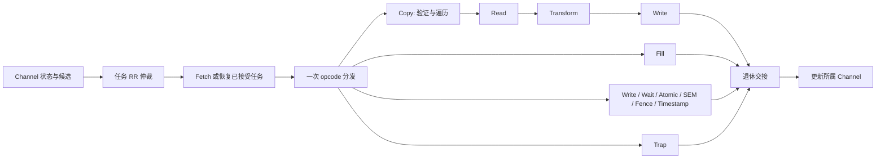

# 共享执行流水与资源设计草案

状态：尚未编码。本文把 [architecture](architecture.md) 的原则展开到状态所有者、
数据交接和吞吐预算。它不是 Rust 模块的逐一翻译，也不引入逻辑 channel 超售。
总线责任见 [memory-interface](memory-interface.md)，跨域关闭见 [reset-cdc](reset-cdc.md)。

## 一条数据通路

各 branch 是 opcode 本身的执行结构，不是另一层按 opcode 再解释一次的 controller。
Copy 内部可以长期推进 read/transform/write；只有命令结束、普通等待或 fault 退出才
释放相应执行 residency，不把每个 chunk 完成变成整个外围流水结束。
图中的状态更新反馈不是“后级调用前级 step”。实现用寄存器、握手和清晰的输入输出。

channel 是持久硬件状态对象，不是一个复制了完整 engine 的 pipeline。候选是对任务的
非拥有观察；仲裁选中任务后 Fetch 再检查其头指针/状态是否仍适用，不能把失效候选
悄悄换成同 channel 的另一个任务。只有实际接受工作才推进 RR cursor，空扫描不转动。

## 状态、接口和端口归属

| 所有者 | 保存的状态 | 输出/修改边界 |
| --- | --- | --- |
| 每个 channel | 配置/游标/IRQ/fatal/fault；已接受原始 command 和 context 引用；遍历/保留数据身份 | 提供候选、寄存器访问、event push、暂停/恢复/退休 |
| 仲裁 | RR cursor、被下游背压的候选 | 提交一个具体任务，不推进候选生产者 |
| Fetch | 当前 descriptor 的读责任、完整 decode 缓冲 | Fresh command 或 retained command；成功接受时安装账本并推进 consumer |
| Copy 遍历 | 验证/执行游标、当前 src/dst 范围和剩余长度 | 一个明确地址、长度、selector 的数据工作项 |
| Read/Transform/Write | 当级持有的数据和下一级握手状态 | 传递 buffer 使用权与结果；不重新验证整个 command |
| scalar/atomic branch | 当前 word 操作及已完成效果、Timestamp 样本 | 一次访问结果、普通等待、park 或 terminal completion |
| bus endpoint | AXI slot、ID、外部请求与返回责任 | 每个内部请求一个 terminal receipt |
| 退休边界 | 已退出执行路径的状态与责任是否结清 | terminal 清 accepted；wait/park 保留 accepted |

跨对象持久状态属于 owner，局部状态属于消费它的阶段；不把全部状态复制到一个
“每条命令上下文”再让各模块维护自己的镜像。仲裁后的工作项必须带实际 channel 身份，
共享阶段访问相应资源，不能固定绑定某个 channel 或执行其它 channel 的方法。

accepted task 的 context 引用与 command consumer 推进在同一个可线性化边界完成。
无效 descriptor 不推进 consumer，走 CommandRead fatal；已成功 decode 后发现非法
操作/范围则按现有 command error 路径处理。ring context 的存活约束独立于某一条
command 的 payload 引用，不能在 enable=0 时就假定 ring 不再绑定 context。

context 的 owner/attributes/valid 表由 hw-components 拥有。原型可评估单查询端口和
流水查询，但要用目标事务率证明它不是瓶颈；不预设一个大组合 mux 可以在任意 K 下
跑到 500MHz，也不为了多个调用点复制权威 context 表。只读解析结果随事务保存。

## Copy/Fill 的工作项与保留窗口

先验证选定的两端范围，再进行 payload 效果；零长度不访问 SG 或 payload。验证只走
选定范围，不扫描不使用的前后段，也不缓存整个 SG list。验证后 execution traversal
从选定起点推进；软件按现有合同保持 metadata 稳定。必要的重复 metadata 读取是
现有“访问前完整验证”语义的成本，不能为优化启动时间擅自移除。

工作项包含 owner、两端地址/selector、字节长度、顺序位置和 buffer handle。
其长度受 src/dst 段边界、地址边界和已预留 buffer 限制。Fill 只有目标、pattern 和
pattern phase，不做虚假的 source read；跨工作项时 pattern 相位必须连续。

候选的有界窗口记录每个工作项：

- 源读取是否完成及保留数据是否有效；transform 是否已完成。
- 目的写是否尚未发射、已 offer、成功或 fault；对应外部责任是否结束。
- 逻辑顺序与两端游标；哪些字节可以计入连续 committed prefix。

这个窗口解决多个物理事务的账目，**本身不授权预读、跨越依赖或乱序产生效果**。
成功写才能推进 committed prefix；仅拿到某个较晚事务的 B 不代表其前驱完成。
读取成功、写入缺页时保留原数据及 transform 结果，直到重试成功或 cleanup。

每个 channel 都必须有可兑现的 parked 存储份额，或者在接收/发射前预留足够资源。
不能让第一个 faulted channel 占满唯一的 scratch 后，仍宣称其它 channel 可以运行。
第一版资源评估先比较 per-channel 固定窗口与有保底 credit 的共享池，优先采用能
直接证明容量的结构；共享池省面积之前必须证明不会产生 fault-induced deadlock。
窗口有 W 个槽、每槽最多 P 字节时，固定份额的 payload 容量为 C*W*P，另加元数据；
这个公式不是要求马上选择某个 W/P，更不是按 Rust Vec 分配一块无限存储。

## 停顿、缺页、错误和同 channel 顺序

健康工作背压上游，保留当前 command。普通 Wait/SEM 未满足时，只保留 accepted 状态
并释放 grant，候选逻辑在后续轮次重试；same-channel successor 仍然不能绕过它。
没有超时成功、等待 event slot 或由 firmware 代为执行这些 word 命令的分支。

遇到 PageFault 停止目标任务新发射，已承诺的事务仍要排空并保存结果。只有工作被
完整转移到 channel 保留资源后才能释放共享 residency；FAULT_STATUS.faulted 公布时
必须已具备安全恢复的状态。平台报告可能先到，软件按原合同等 faulted 后再 resume。
peer 是否能在目标事务收尾期间就运行，取决于是否已完成全部局部 owner 交接；不能
只清一个全局 active 位就抛弃尚在途的数据。可用资源和外部返回正常时，peer 必须推进。

永久错误先 latch stop，再由 channel 的 event producer 发一次 error event；没有
独立的成功事件 stage。event写成功才发布 producer；满/损坏/写失败转 fatal，不作为
普通 admission 反压。退休等 resident 和 bus 责任都结束；IRQ 出现不是提前释放许可。

默认不重叠同 channel 不同 command 的内存效果。这直接保持 Wait/Fence 和成功顺序，
也是第一版不需要推测依赖图的原因。可预取 descriptor 的设计也必须保留未接受状态，
不能推进 consumer、安装错误的引用或触发 payload；预取不是当前必选实现。

## 本轮发现的真实兼容性问题

### 预读会改变已定义的重叠 SG 行为

当前 [PF-D02](../../model/modeling/docs/page-fault-recovery.md#pf-d02-retain-committed-progress-and-read-scratch)
与 [overlapping_segments_follow_execution_order](../../model/modeling/crates/dma/tests/scatter_gather.rs)
有明确证据：初始 `abcdef`，先把 `ab` 写到后续 source 所在位置，再读取它，最终是
`ababab`。如果提前把第二段的 `cd` 读进窗口，结果会变成 `ababcd`。
两者都没有回滚，但只有前者满足这条已有场景。不能把它当作过时测试删掉。

因此不能仅凭“chunk 完成不回外围流水”就推出可无条件跨 chunk 预读。不同 context
还可能指向物理别名；DMA 看不到 MMU 翻译结果，仅比较 VA 和 context ID 不能证明
物理不重叠。持有更多 buffer 也不能修复这一语义差异。

草案保留两条边界：保序执行是功能基线；跨工作项的高吞吐流水必须先证明无依赖，
或另行明确软件/平台的别名与访问顺序合同。本轮不新增 descriptor 模式位、不加入
地址翻译，也不擅自把重叠情形改为 undefined。这个问题阻塞“任意合法输入均可满
吞吐”的承诺，但不阻塞 register/CDC/AXI endpoint 的独立设计和实现。

### Error 的 prefix 不等于全部物理效果的集合

`Event.info.bytes_completed` 定义的是连续 committed prefix。多 outstanding 下，如果
前项失败、后项已写成功，仅有一个 prefix 无法描述所有已生效字节。当前 synchronous
model 不会产生这种交织。reset 不回滚不能自动证明这种永久失败结果已经与 model
等价；必须在允许该发射策略前明确 event 的保证边界。

对于可恢复 fault，窗口可以保留每项结果：后项已成功的写不重放，只补未完成项，
等缺口填满再推进 prefix。但它仍不能消除前一节的读写依赖问题。永久错误的方案需
选择限制效果顺序，或者明确 prefix 只是已确认前缀、其后可能有在途效果；后者会影响
软件恢复合同，不能作为内部优化默默采用。本轮保持这个判定点可见，不宣称解决了。

## 吞吐、时钟比和资源预算

沿用 `T_ref=min(R,W,M/2)` 的外部参考，不能把低速内部 stage 放进分母。D 是总线
每 beat 字节数；core 处理 P_core 字节/周期时，至少要求 `P_core*f_core >= T_ref`。
双口/分银行 RAM 的端口字节率也必须分别覆盖读填充和写取数，不能只算总容量。

若平均事务有效字节为 B、回执往返时间为 L，隐藏延迟所需 in-flight 数据至少近似
`T_ref*L`，相应 slot 下界约为 `ceil(T_ref*L/B)`；再加入 CDC credit 往返、调度和头尾
开销。这个下界不是充分保证：RAM 冲突、SG 边界、协议气泡和依赖均需实测。

零额外内存等待不等于零 CDC 延迟。不能每完成一个 burst 才往返跨域申请下一份 credit；
端点队列要能在有合法工作时连续服务。反过来，在依赖要求下串行等待是语义成本，
不能隐藏在“已经达到自己定义的峰值”中。保序基线是否满足长 Copy 目标尚未证实。

参数评估记录 C、K、D、W、P、slot 数、RAM 端口、三个时钟及 CDC 深度，分别报告：

| 用例 | 观测 |
| --- | --- |
| 长、对齐、互不依赖的 Linear Copy | 启动/稳态/收尾，有效字节率及每类空泡 |
| 很短的连续 command | descriptor/仲裁/寄存器发布开销，不能用大传输结果代替 |
| 独立源/目的 SG、非对齐头尾 | 元数据与窄访问成本；没有越界读写 |
| 现有重叠 SG | 精确结果必须保持，不用吞吐门槛覆盖正确性 |
| 一个 channel parked、其它可运行 | buffer 保留、peer 进度、复用与重试不重复效果 |
| 全部 channel parked，再分别 resume/reset | 容量不超额，无资源循环等待 |
| 满事务窗口时单 channel reset | 不清 peer，全部目标责任结束后 busy 才清 |

最终 C/K 上限、RAM 宏和频率范围需综合/时序及功能矩阵共同确认。22nm、500MHz
不是可推导这些值的充分条件，本轮不会硬写一组未经验证的“产品规格”。

## 接下来可独立落实的顺序

先冻结寄存器 transport 的访问规则和 ContextRequest 格式，再做带真实握手的寄存器
前端/CDC；并行在设计层面完善 AXI slot/return/atomic profile 和关闭账本。第一条功能
切片用两个 channel 共享执行、真实内存响应、Copy/Fence/Trap 和 reset，先证明责任
边界，再扩大参数与命令覆盖。不得因切片较小而丢掉 managed 接口和其它 opcode 的设计。

在高速 Copy 发射优化前，必须结束上面两个等价性问题；通过现有 Rust tests 或工具
smoke 都不能证明它们。待明确后，再把所需的系统合同补进规范并写 RTL 行为测试。
