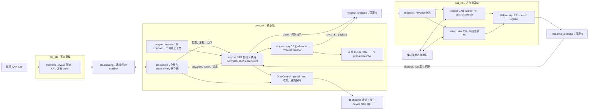
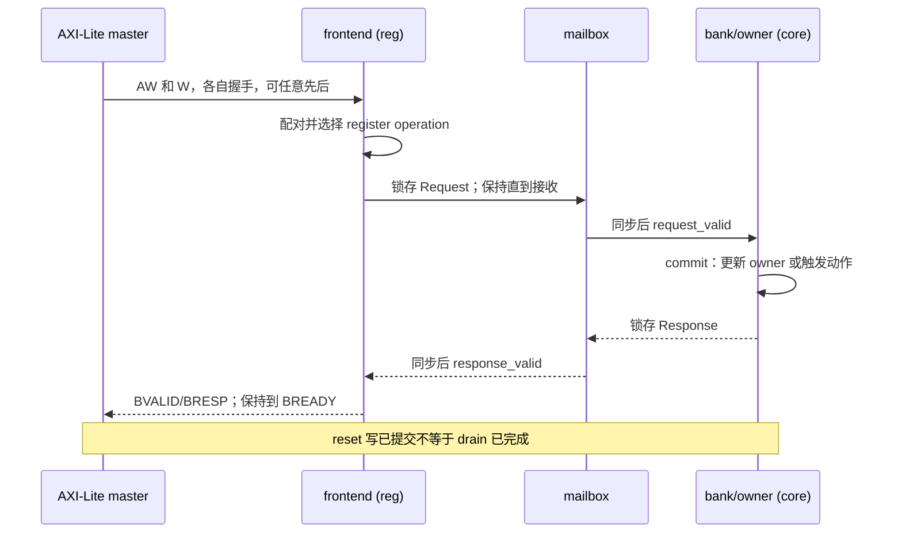
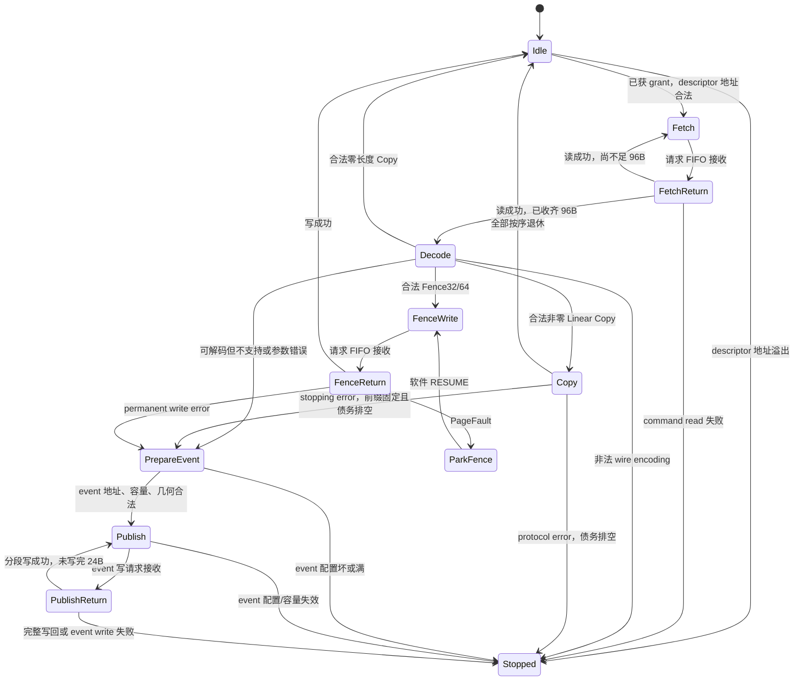
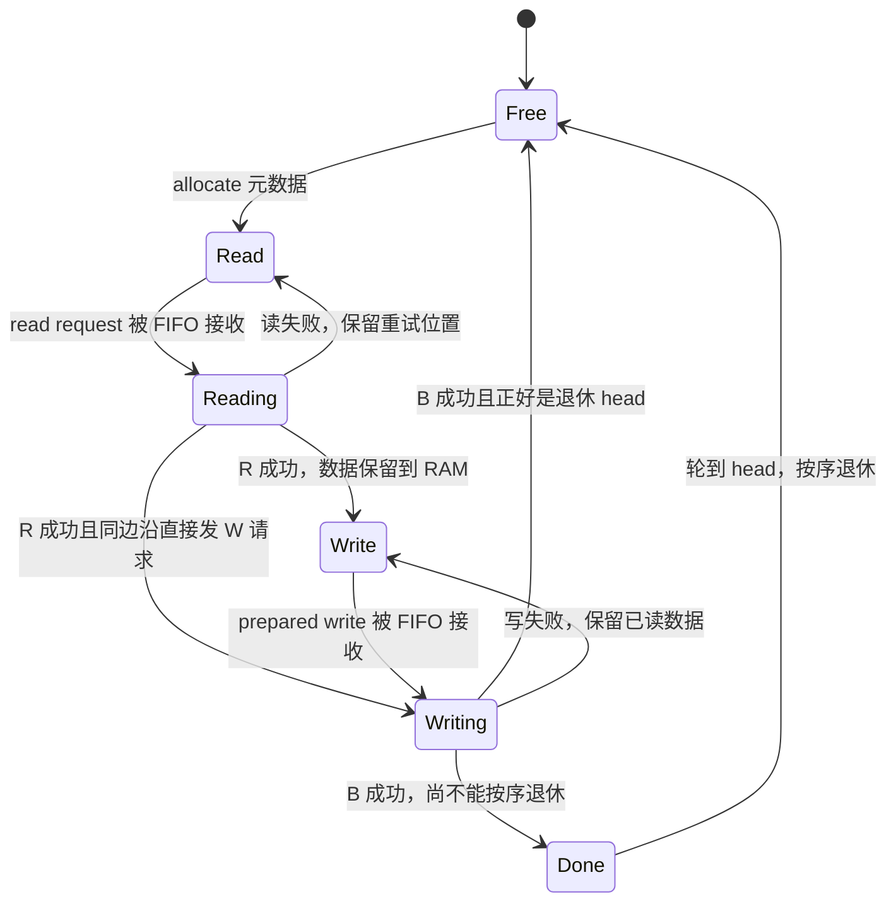
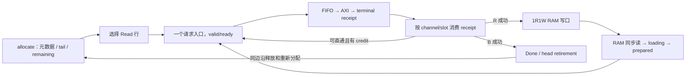
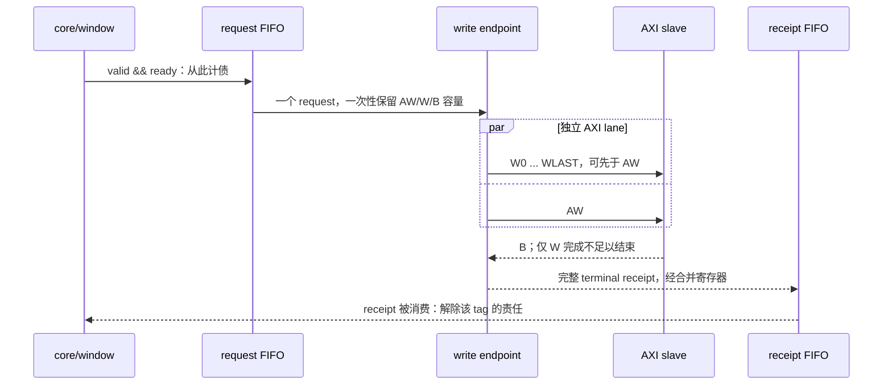
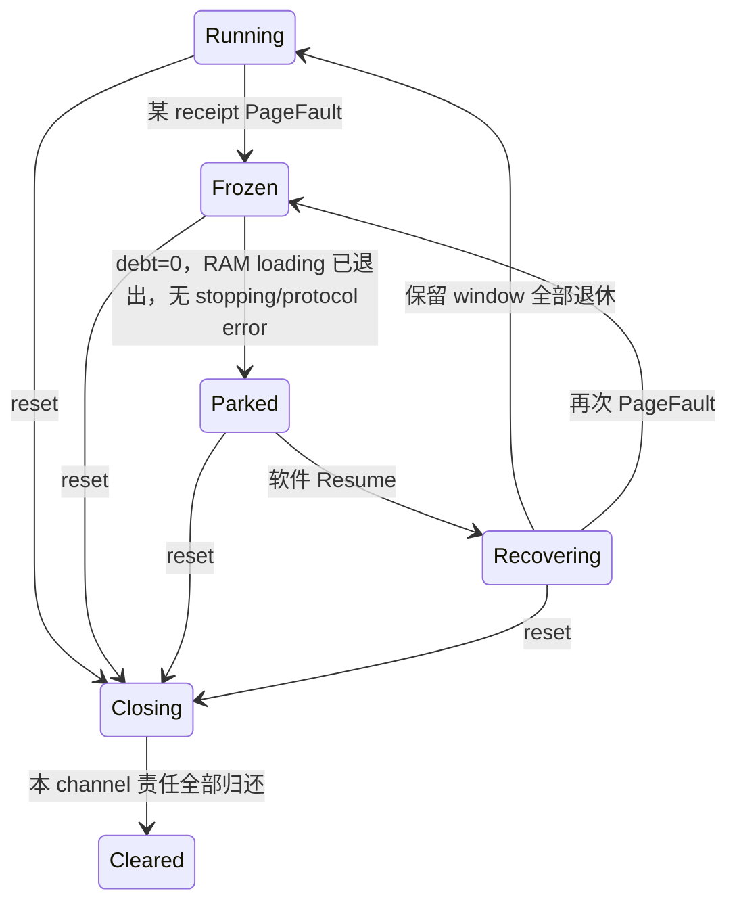
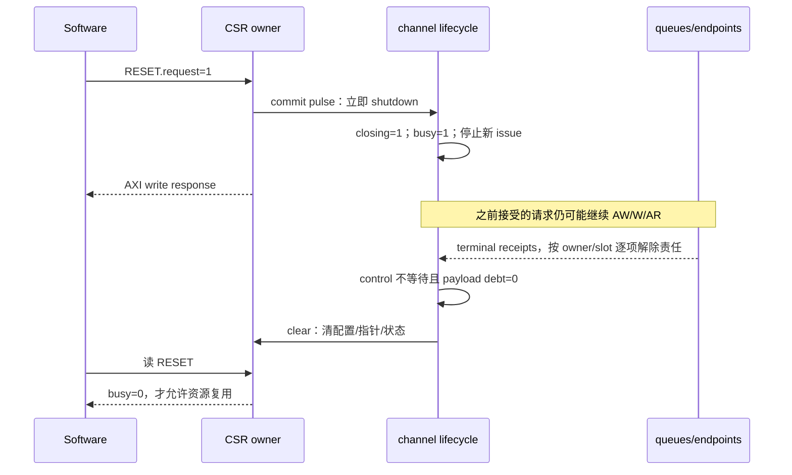

# DMA Copy/Fence 微架构：与当前 RTL 对应

本文描述 `DmaCopy` 的当前源码组织。2026-11-18 的配置与职责调整已通过功能
矩阵及 2/8 channel CDC/RDC 检查；默认 2 channel 和窄接口配置的综合已通过，
8 channel 和宽接口综合仍在运行。各阶段证据见
[验证记录](../../verification/dma/results.md)，旧源码的结果不作为新版资格证据。
本文的路径采用整理后的主工作区。体系结构语义以
[系统规范](../../model/modeling/docs/spec.md)及
[命令合同](../../model/modeling/docs/copy-engine.md)为准；未来配置与尚未实现的
模块见 [架构计划](architecture.md)。最新实测单列在 [性能说明](performance.md)。

## 1. 范围、层次和边界

当前实现：1..8 个物理 channel、一套共享 Linear Copy/Fence32/64 执行资源，
三个异步时钟域。配置不可通过软件改变 channel 数。命令记录为 96B，错误事件
为 24B。正常完成不写 event；软件通过后继 Fence 的内存标记确认完成。
Fence 保证本 channel 的先前任务已退休再发标记；它不是跨 channel/global barrier，
也不替平台实现 cache coherence。平台仍须满足其事务完成与内存可见性合同。

顶层静态配置支持 32/64-bit AXI4-Lite 数据接口及 32..1024-bit 普通内存数据
接口；内存地址仍为 64-bit。默认 profile 为寄存器 32-bit、内存 64-bit。
内存口沿用 AXI4 普通事务子集，AWATOP 为零；不是完整 AXI5 atomic 实现。
数据宽度、burst 上限、每 channel 保留槽、读写 outstanding 和 CDC 深度的依赖
见 [配置说明](configuration.md)。合法配置与完成物理资格检查是两件事。
SG、Write/Fill/Wait/Atomic/Semaphore/Trap/Timestamp、外围权限检查、CPU 和
firmware RTL 仍未在这个切片实现。

### 1.1 目录是职责分组，不全是实例包含关系

`control/registers/bus.veryl` 声明的是 **RegisterBus 请求/响应类型和 RegisterPort**：
它没有 AXI 引脚、仲裁器、FIFO 或状态寄存器，也不是系统总线。放在寄存器访问
职责组内合理，但文件名 `bus` 不足以表达“内部寄存器事务协议”，不能据此推断
DMA 的所有 bus 都从属于 registers。本文区分以下三种关系：

| 关系 | 例子 | 对硬件的含义 |
| --- | --- | --- |
| 实例包含 | `control.csr.owners.channels[i].owner.command_ring` | 真正的 module instance 层次 |
| 类型/接口依赖 | RegisterFrontend 和 DmaRegisterBank 使用 RegisterPort | 同一协议，两端各有自己的实例/状态，不是类型声明拥有使用者 |
| 共享算法 | 多处调用 `common_cell::RoundRobin::select` | 每个调用者拥有自己的候选与授权状态，没有一个隐藏的全局仲裁 module |

上一次目录图只展示了部分包含关系，不能替代这里的协议、状态和共享资源关系。
现在不为每个算法函数再加一个 wrapper module，也不把所有 arbitration 收进一个
跨职责的 controller。进一步拆分 `CopyEngine` 时应以真实寄存器切点和状态归属为
依据；当前 admission/decode/控制请求状态机确实还在同一模块中。

### 1.2 实际实例树与源码

```text
DmaConfigured                               由静态 profile 生成，无状态
└─ dma: DmaCopy                              copy.veryl
   ├─ channels: DmaChannels                  control/interface.veryl，连线接口
   ├─ control: DmaControl                    control/control.veryl
   │  └─ csr: DmaRegisterInterface           control/registers/interface.veryl
   │     ├─ frontend: RegisterFrontend
   │     ├─ crossing: DuplexMailbox
   │     └─ owners: DmaRegisterBank
   │        └─ channels[i].owner: ChannelRegisters
   │           ├─ command_ring: RingRegisters
   │           └─ event_ring: RingRegisters
   ├─ engine: CopyEngine                     execution/engine.veryl
   │  └─ copy: CopyWindow                    execution/copy/window.veryl
   │     └─ buffers: Ram1R1W                 共用的、按 channel 保留行的 RAM
   └─ transport: DmaMemoryBridge             memory/bridge.veryl
      ├─ request_crossing: AsyncQueue
      ├─ response_crossing: AsyncQueue
      └─ endpoint: CopyMemoryEndpoint
         ├─ reader: CopyReadEndpoint
         ├─ writer: CopyWriteEndpoint
         └─ result: ReadyValidSlice
```

主要实现入口：[顶层][top]、[寄存器桥接](../../rtl/src/dma/control/registers/interface.veryl)、
[全局 bank](../../rtl/src/dma/control/registers/bank/bank.veryl)、
[channel owner](../../rtl/src/dma/control/registers/bank/channel/channel.veryl)、
[ring owner](../../rtl/src/dma/control/registers/bank/channel/ring.veryl)、[共享引擎][engine]、
[burst window][window]、[内存端点][endpoint]、
[read lane](../../rtl/src/dma/memory/endpoint/read.veryl)、
[write lane](../../rtl/src/dma/memory/endpoint/write.veryl)。

协议与公共声明入口：
[RegisterBus/RegisterPort][register-protocol]、[RegisterState][register-state]、
[RegisterAccess][access]、[CommandState][command]、[CopyMemory/CopyMemoryPort][memory]、
[生成的 layout][layout]。package 提供类型、常量和函数，不创建 module 实例；
interface 则有真实连线实例，例如 `source_port/target_port`、`requests/transactions`。
这些 interface 本身不增加存储或仲裁。Veryl package 的名字不等同于源文件目录。

### 1.3 顶层框图

下图以默认 8 槽、8 深度 profile 表示容量；它们均为静态配置输入。



图中 core→bus 的控制访问与 payload 共用一个请求入口；不是两个可以同时发射
的物理端口。回执消费按 tag 更新 owner，即使 owner 因 reset 已交回执行授权。

## 2. 状态、存储和身份

### 2.1 每份状态只有一个权威 owner

| 状态/资源 | 权威 owner | 容量/组织 | 释放边界 |
| --- | --- | --- | --- |
| channel enable、configured、ring_context、IRQ 配置 | ChannelRegisters | 每 channel 一份 | channel clear |
| ring base/capacity/producer/consumer | 两个 RingRegisters | 每 channel 一对 | channel clear；正常按各自软/硬件游标推进 |
| descriptor、phase、control_address、错误前缀/状态 | `engine.contexts[c]` | 每 channel 一个 `CommandState::Context` | 终态转 Idle 或 clear；park 保留 |
| 当前执行授权 | `engine.locked/owner/cursor` | 全机一份 | 命令终态、安全 park、shutdown/fatal |
| burst 元数据和状态 | CopyWindow | SLOTS 行/channel；扁平 row=`channel*SLOTS+slot` | 写成功按序退休，或完成取消后的 clear |
| 读回的 payload | `copy.buffers` | `(SLOTS*C) × BURST_BITS`，一读一写端口 | 对应 row 安全复用；不靠清零 RAM 内容释放 |
| prepared/加载中的写数据 | CopyWindow | 全机一个 BURST_BITS cache，带 channel/slot | 已发写或失去当前 owner；权威数据仍在 RAM |
| 已承诺 payload 请求数 | `copy.debt[c]` | 每 channel 可表示 0..SLOTS 的 counter | 自己的 terminal receipt，R→W 同拍可净变化为零 |
| 控制访问在途责任 | `contexts[c].phase` | FetchReturn/FenceReturn/PublishReturn | 自己的 slot-0 receipt |
| global reset 收集集合 | `DmaControl.global_pending` | C bit | 每 channel clear；集合归零才 global clear |
| 待交付通知 | `DmaControl.irq/fatal_irq` | C+1 bit | 接收方 ready，或相应 reset clear |

`RegisterState` 是这些对象之间的 live view，不在 `DmaCopy` 再维护一份影子
register bank。command consumer 的推进表示**描述符已接受**，不是命令已完成；
完成仍由 Fence 或错误路径表达。

### 2.2 请求身份与空间身份不能混淆

| 字段 | 当前编码 | 用途 |
| --- | --- | --- |
| 内部 `Tag.channel` | 3 bit，实际合法范围 `< CHANNEL_COUNT` | 归还给哪个物理 channel |
| 内部 `Tag.slot` | `ceil(log2(SLOTS+1))` bit；0=控制，1..SLOTS=burst row | 归还哪份在途责任 |
| `Request.selector` | 32 bit | ring/source/destination/Fence 的 context selector |
| AXI ARUSER/AWUSER | 35 bit：`{channel[2:0], selector[31:0]}` | 集成平台进一步处理身份与地址空间 |
| AXI ID | 读、写分别固定 0 | 利用同方向同 ID 返回顺序；不作为 channel 身份 |

默认 profile 的内部请求 622 bit，回执 522 bit；寄存器 mailbox 请求 106 bit、响应 66 bit。
请求与回执随 burst 容量和 slot 身份位宽变化；寄存器 mailbox 保持内部 64-bit 数据格式。
这些是 packed 字段的逻辑宽度，不是物理面积估计。DMA 不在这里实现
Function/PASID 查表、MMU、ATS/PRI 或 fault tag 的平台映射。

### 2.3 容量和物理实现边界

| 资源 | 静态容量（括号内为默认值） | 含义 |
| --- | --- | --- |
| core→bus 请求 FIFO | REQUEST_DEPTH（8） | 接收即产生事务义务，尚未到 AXI 也计债 |
| bus→core 回执 FIFO | RECEIPT_DEPTH（8） | 每个内部请求一个完整 receipt，不是每 beat 一个 |
| reader pending | READ_OUTSTANDING（8） | AR 后等待 terminal R 的有序 tracker |
| writer addresses/data/responses | 各 WRITE_OUTSTANDING（8） | 同一个请求一次性保留三队列容量，分别在 AW/WLAST/B 释放 |
| reader / writer receipt register | 各 1 | 保持完整回执并施加背压 |
| 合并 result register | 1 | 仲裁后稳定保持，防止背压时被新候选替换 |
| burst RAM | `SLOTS*BURST_BYTES`/channel（512B）；默认 8 channel 为 4KiB | 固定保留配额，park 的 channel 不占掉 peer 的配额 |

RAM 为一个共享 1R1W owner，并非 8 个独立执行引擎。FIFO storage 仍参与综合。
control-budget 综合只给 RAM 保留边界负载模型；不能把 placeholder 的零面积和
边界延迟当成 SRAM 的真实属性，见 [memory-budget](memory-budget.md)。

## 3. 仲裁：位置、粒度、授权和背压

| 位置/代码 | 候选 | 选择规则 | 何时前进/保持 |
| --- | --- | --- | --- |
| [RegisterFrontend][frontend]：`choose_write/dispatch/prefer_read` | 配对完成的 AW+W 与 AR | 双方都有时按 prefer_read 交替；单方就绪即可选 | dispatch 更新偏好；一次只推进一个内部 register operation |
| [CopyEngine][engine]：`eligible/choice/chosen` | 合法 Idle 新任务、可运行 Copy、待重试 FenceWrite | `RoundRobin<8>::select(eligible,cursor)`；超出实例数的 bit 恒零 | grant 时锁存 owner，并按实际 C 回绕 cursor；健康 command 保持授权 |
| [CopyWindow][window]：`read_choice/write_choice` | 当前 channel 的 Read/Write 行 | 从退休 head 起找第一个对应状态行 | head 只在按序写退休时前进；这是有序优先选择，不是每 cycle 轮换 slot |
| [CopyWindow][window]：`selected_slot/memory.valid` | prepared write、可直接转发的 R、候选读 | prepared write 优先；可用返回直通其次；然后发读 | 写数据尚在同步 RAM 加载中时，可继续发其它读；stop_issue 关闭所有新发射 |
| [CopyMemoryEndpoint][endpoint]：`selected/cursor/result` | reader receipt、writer receipt | 2 路 RR | 只有合并入口实际握手才前进；result 寄存器负责稳定保持 |

寄存器 bank 的 `matched` 选择是**地址译码**，地址窗口互斥，不是多个请求者争抢
一个资源，因此不应叫仲裁。

### 3.1 Channel grant 的精确定义

`eligible[c]` 要求：没有全局阻塞、没有该 channel shutdown，enable=1，没有停止
错误/fatal，且处于上述可运行状态。`locked=0` 才采纳 choice；锁存后 `selected`
只取 owner，**不组合穿透 RR 到地址计算**。

正常 Copy 从 fetch 到全部 payload 退休都保留授权；不会每 burst 重新仲裁。
普通外部 AXI 背压也不会自动让出授权。已锁定 owner 的 enable 被清零时，
请求会暂停，但 enable↓ 本身不是 yield/reset；不能据此期待立即调度 peer。PageFault 只有排空旧事务、保留好状态后
才 park 并让出。FenceWrite 恢复及已停放 Copy 再次参加同一个 RR。

这提供命令边界的轮询机会，不提供按字节分时或有界抢占。长 Copy 可以让 peer
等待很久；若平台一直不返回某笔请求，没有有限的调度/完成延迟保证。
多个 channel 不会把同一个 memory master 的峰值带宽乘以 channel 数。

### 3.2 Shared ingress 的 head-of-line 阻塞

请求 FIFO 头按 `write` 决定要交给哪个 endpoint；只有对应 endpoint ready 才 pop。
头部写因写队列满而停住，会阻塞其后的读进入 reader；反向同理。已经进入两条
lane 的事务仍可独立推进。当前实现没有按 channel/方向旁路队头的输入重排器。

## 4. Register path 与软件可见提交边界

1. frontend 分别保留 AW、W、AR，每个方向 credit 一直占到对应 B/R 被软件接收。
2. 配对的写与读经本地选择，形成一个 RegisterBus::Request，保留原 AXI 地址和 lane。
3. DuplexMailbox 以各两级同步的请求/响应握手传递完整 payload；不拆开 valid/data。
4. bank 对全局及 channel/ring owner 求候选结果；真正 `commit` 才修改权威状态。
5. bank 锁存 Response，响应 mailbox 返回 frontend，后者保持 B/R 直到 AXI 接收。

`RegisterAccess::leaf` 只是纯访问计算：窗口、RO/WO、32/64-bit lane、strobe、保留位
检查；不产生第二份存储。32-bit bus 写 64-bit 配置值时，两半各自提交；软件必须
在禁用/配置期写完整，再 enable，硬件不推测一个跨 transaction 的“软件原子写”。
详细地址矩阵见 [register-interface](register-interface.md)。

Ring 配置要求 power-of-two capacity、合法 alignment、范围不溢出；指针按 32-bit
计数差判断占用，用 capacity mask 得 entry 地址。enable 后 configured 锁存，
base/capacity/ring_context 不能靠临时 disable 随意重绑定；reset clear 解除配置生命周期。
动作寄存器在 core commit 给出单周期 pulse；AXI 写响应表示该请求已提交，并不表示
软件 reset 的 drain 已完成，完成要读 reset busy。



## 5. Channel 命令状态机

状态定义在 [CommandState][command]，组合 next 和顺序更新在 [CopyEngine][engine]。
以下状态在 `contexts[c]` 内逐 channel 保存，计算资源由 selected owner 共享。



Copy 的 page fault **不改变外层 phase=Copy**，而是在 window 冻结，安全 parked 后
让出 locked；不能在图中误画成 command completion。Resume 不重新 fetch descriptor。

| 阶段 | 寄存器切点和副作用 |
| --- | --- |
| grant | 锁存 owner，下一拍才能使用该 context |
| Idle→Fetch | 保存 descriptor 起始地址；`fetched=0`，descriptor 暂存清零 |
| FetchReturn | 完整 burst receipt 拼入 768-bit descriptor；成功后才增加 fetched/address |
| Decode | wire encoding 有效才 command_advance；malformed 不消费；Unsupported 消费后进入错误路径 |
| Decode→Copy | 注册 `copy_start[c]`，window 下一边沿接收初始化 |
| Copy | 仅启动一次 window；chunk 内循环不经过外部 Fetch/Decode |
| Decode→FenceWrite | 保存目标地址；value/context 留在已接受 descriptor 中 |
| PrepareEvent | 固定 event 起始地址；与后续请求 FIFO 输入之间有寄存器切点 |
| PublishReturn | 全部 24B 写成功后才 event_advance；部分写不能提前暴露 producer |

默认 profile 的 descriptor fetch 通常为 64B+32B 两个串行读；遇 4KiB 边界继续切分，始终不越界。
控制访问每 beat 为 `min(DATA_BYTES,8)` 字节，每笔不超过 BURST_BEATS；32-bit
memory 的 Fence64 因而是两个 beat。更宽的总线上，控制读写按窄传输 lane 排列。
控制请求 tag.slot=0，只允许该 channel 一个在途控制访问。Fetch/Publish 的失败不能
作为可恢复 payload fault：前者无法可信解码，后者破坏错误上报通路，均转 channel fatal。

## 6. Copy burst window 和流水组织

### 6.1 分段与 row 分配

每次分配只处理当前 selected channel：

```text
portion = min(remaining, BURST_BYTES, 4096-src[11:0], 4096-dst[11:0])
amount  = src、dst 都 DATA_BYTES 对齐且 portion>=DATA_BYTES
          ? floor(portion/DATA_BYTES)*DATA_BYTES : 1
row     = channel*SLOTS + tail
```

metadata `{source,destination,length}` 写到该行；tail 和 next_source/destination、
remaining 同时前进。不能分配到尚未安全退休的行。`recovering` 时先清完保留 window，
然后才继续分配后面的新数据。

若 src/dst 的 bus-word 内 offset 不同，逐字节推进不会使二者同时 DATA_BYTES 对齐：整个任务可能走 byte
路径。这是当前实现的明确吞吐限制，不应把 aligned 的结果推广到任意 offset。

### 6.2 每行状态机



图中的“失败→Read/Write”不会自动继续重试：PageFault 同时设置 frozen，permanent
error 设置 error_code，二者均关闭新 issue。只有软件 Resume 或 reset 生命周期允许
后续处理。clear 只在责任排空后将全部行状态置 Free；RAM 内容本身不需要 reset。

### 6.3 数据通路与反压



它是一条有 retained window 的 request/receipt 流水，不是“每行都串行等 R→B 后
才处理下一行”。多个 row 的读、写可以同时在不同流水位置；同一行仍先读后写。

* 快路径：R receipt 可直接成为同拍 write request，且同时保存到 RAM；不经过
  同步 RAM 回读。必须没有旧 writable/prepared/loading 冲突。
* 回退路径：先读 RAM，一拍进入 loading，再把有效读数据保存到 prepared_data。
  prepared 带 owner/slot，可在背压下保持；不会把无效期 RAM 输出当有效数据。
* successful head B 可在本拍退休并复用同一 row，下一周期发新 Read，避免额外的
  Done→Free→Allocate 空泡。非 head 成功先存 Done。
* 同拍 R 完成和 W 被接收时，debt 保持不变；不能误认为 read 责任归还后没有新 write。
* prepared cache 失效只丢弃可重建副本，不能销毁权威 RAM 数据。

### 6.4 同一 core 边沿的优先级

| 同时发生 | 结果 |
| --- | --- |
| clear 与 start | clear 优先，不能开始新工作 |
| cancel 与 start | 不开始；不能靠初始化清掉既有债务 |
| selected receipt 报错与新 issue | stop_issue 当拍阻止新接收 |
| terminal receipt 与发送新请求 | debt 按二者组合更新，不做两个互相覆盖的赋值 |
| successful head B 与 allocate 同行 | 先视为退休，最终行状态为 Read，metadata 属于新 chunk |
| R 成功与 direct W 接收 | 最终行状态 Writing，不落回 Write；数据仍落 RAM |
| error 快照后又有 successful receipt | 可用于 drain/实际内存完成，不能扩大冻结的错误前缀 |

## 7. Memory endpoint 与 transaction 责任

### 7.1 Read lane

AR 只在 pending tracker 有空间时发送；握手时保存 tag、lane、size、length。
同方向 AXI ID 固定为零，R burst 顺序对应 tracker 队头。R 数据收齐到一个 BURST_BITS
receipt；只有 RLAST 发布完整回执和 pop tracker，最后一拍还受 receipt credit 限制。
单字节读只提取地址对应 lane，不对外承诺其它字节。

任意 beat 的 permanent error 会使整笔读失败；PageFault 分类要求相应错误响应和
USER=1，并且该 burst 不能混入使它成为永久错误的响应。RID、RLAST 位置、EXOKAY
及非法 USER/response 组合被识别为 protocol_error。

### 7.2 Write lane

接受内部 request 时同时向 addresses/data/responses 三个队列写入，只有三者都有
容量才 ready。AW 和 W 互不要求先后，可以先完成 W 再握手 AW。BREADY 需要：

```text
response tracker 非空
&& addressed != completed
&& written   != completed
&& 本地 receipt register 有 credit
```

addressed 在 AW 握手增加，written 在 WLAST 握手增加，completed 在 B 握手增加；
有序 ID-zero 响应关联最老的 tag。不能仅凭发送 WLAST 就完成任务或解除 reset 债务。
Fence32 按 lane 形成四字节 strobe；Fence64 为八字节；Copy 的 byte path 形成单字节 strobe。

### 7.3 回执合并与返回

reader/writer 各先有一个 Forward slice，再经 RR 和一个合并 Forward slice，最后进
bus→core AsyncQueue。合并寄存器防止在 core 背压时，后来出现的候选替换已经承诺
的 receipt。R/B 允许彼此交错，core 按 tag 找到权威 owner，不能依赖“最近发出的 channel”。



## 8. Fault、error、fatal 和 reset

### 8.1 三类终态边界

| 类别 | 立即动作 | 排空/保留 | 软件观察与恢复 |
| --- | --- | --- | --- |
| payload/Fence PageFault | 停止该工作的新 issue | 收齐已承诺请求；保留 descriptor、row 和成功读数据 | safe park 后 faulted=1；不发 fault event/IRQ；修复后 Resume |
| stopping command error | 固定 error_code，停止新 issue | 固定成功连续前缀；收齐债务再写 event | error 可先于 event 可见；event 发布后通知；需 channel reset |
| channel fatal | command read 或错误报告不可用 | 停止该 channel；保留诊断 | fatal 状态及通知；需 channel reset |
| device fatal | malformed transaction/protocol violation | 全局停止新 issue；继续必要的回执责任处理 | 独立 fatal/notification；需 DMA reset |

`bytes_completed` 只表示识别 stopping error 时已确认成功的连续逻辑前缀。
不是“成功 byte 总数”，也不是“前缀以外未写过”。错误之后先前已发出的写仍可能
成功。前缀由 `failure_successes/failure_head/error_prefix` 的冻结集合逐行求出，
晚到成功 receipt 不改变它。

### 8.2 PageFault 的 channel 状态



Copy 的 frozen/parked/recovering 是 window 层状态；Fence 用 ParkFence 保存写目标和值。
这些不是新的顶层 central controller。停放 A 不占用 B 的保留行，但共享 FIFO/AXI
顺序仍可能延迟 B，不能承诺任意总线背压下 peer 完全不受影响。

### 8.3 软件 reset 状态与时序

1. action commit 的周期已进入 `shutdown = closing | reset_request | reset_all`，
   当拍阻止新 issue；下一边沿锁存 closing。
2. 已被 core 请求 FIFO 接收的所有请求继续走完，包括还在跨域 FIFO、未到 AXI 的请求。
3. closing owner 可以释放执行 grant；其回执仍按 channel/slot 消费。slot-0 phase
   以及 `copy.debt` 各自保留义务，不能只看当前 AXI 引脚是否空闲。
4. `clear[c] = closing[c] && !waiting(contexts[c].phase) && copy_drained[c]`。
   清除只影响 c 的寄存器/上下文/row valid/cache owner，不 reset 共享 FIFO/endpoint。
5. global reset 用 global_pending 收集各 channel clear。新 reset 与旧 clear 同拍时
   新请求优先保留 closing，避免全局收集遗漏一次确认。



若平台永不返回一笔已接收事务，本切片不承诺 reset 在有限时间成功；不能凭超时
伪造 drain 完成。三个物理 reset 必须一起异步拉低、分别按本域同步释放；单独热
复位一个 live clock domain 不受支持。软件 reset 与这些物理 reset 完全不同。

## 9. IRQ 与状态可见性

通知端口是 retained valid/ready，不是存放软件 handler 的对象。每 channel 一个
pending bit，另有 device fatal pending bit。clear/ready 解除旧 pending，同拍新的
合法源可再次置位；channel clear 优先禁止该 channel 的新置位。

当前 Copy/Fence 切片的 channel 通知来自 event_advance 或 channel fatal 新出现，
受该 channel irq_enable 控制；device fatal 使用独立 global_irq_enable。enable
不会重放旧状态。Error/Fatal 按系统合同绕过 routine source mask。

`irq_mask`、trap_ack 和 trap cause 的寄存器形状已存在，但当前切片不执行 Trap，
也没有独立正常事件源；不要将寄存器存在当作完整 Trap/mask 执行路径已实现。
所有错误事件都让 channel 停止；本切片的通知时点以 [copy.veryl][top] 的
always_ff 为准，不能用未来完整 model 的 IRQ 单元替代当前电路图。

## 10. 流水寄存器切点和关键时序

### 10.1 不带背压的 core 启动边沿

表中 C0/C1 是 core 上升沿；所列状态变化发生在该边沿后。

| 边沿 | 条件/动作 | 随后可见 |
| --- | --- | --- |
| C0 | unlocked 且 choice 有效，grant | owner/locked 注册，开始使用该 channel 的 Idle context |
| C1 | Idle 地址计算与保存 | phase=Fetch、control_address 已注册 |
| C2 | Fetch 且请求 FIFO ready | 第一笔 descriptor request 接收，phase=FetchReturn |

所以无背压 grant→第一次 issue 为 2 core cycles；不是 RR 函数有 2 拍延迟。
Decode→Copy 时：D0 注册 copy_start；D1 window 接收 start；D2 分配第一行；D3
可发首笔 payload read。因此 window 接收 start→首次 payload issue 为 2 core cycles。
clock phase、FIFO/full、enable 或 reset 条件可以延长这些区间。

### 10.2 一笔 burst 的稳态直通时序

以下是目标等频、固定相位、无背压的一次**实测对应路径**。异步端到端相位不必是
整数 bus cycle；不得将数值写成所有平台的固定延迟合同。

```text
bus t=0       最后一拍 R 握手；reader receipt 寄存器接收
bus t=1       RR 合并到 result 寄存器
bus t=2       result 进入 response FIFO
core t=6.820  core 消费 R receipt；同拍直通为 write request，进入 request FIFO
bus t=11     write endpoint 接收 request，三队列入队
bus t=12     第一拍 W 握手
```

这里两个跨域区间分别测得 4.820ns、4.180ns；组合为完整同 burst 的 last-R→first-W
12 bus cycles。其它 burst 的 R/W 可以并行，所以交接延迟 12 并不等于每个 burst
之间存在 12 拍 bubble。一次 shared return 仲裁竞争、RAM 回退、异步相位变化或
任意下游背压都会改变单笔延迟；详见 [实测与指标定义](performance.md)。

### 10.3 同拍退休/复用与背压保持

```text
edge K:   接收 head 的成功 B；head 退休；若有剩余数据，tail 同行立即改写成新 Read
cycle K+: 新 row 的 metadata/Read 状态已有效；下一周期可发请求
edge K+1: 新 Read 被请求 FIFO 接收（若有 credit）
```

准备写数据的慢路径：RAM read enable 在 L0 采样，loading=1；L1 保存有效 RAM data，
prepared=1；随后才能发 prepared write。若 request ready=0，prepared_data/owner/slot
保持；释放当前授权后可以丢这个 cache，但必须留下 RAM 和 row 状态。

## 11. CDC、时序约束与验证映射

reg/core 用 DuplexMailbox；持续带宽的 core/bus 用 AsyncQueue。共享库实现两级
同步与 Gray pointer/握手协议，应用没有再叠加 up 信号。冷复位是域级合同；软件
reset 保持这些 transport 运行。

跨域约束由包资源提供，平台创建时钟并绑定实例。当前 profile 用 0.5ns crossing
预算，并保留同步链内部的正常本域时序；不是对整个异步 clock group 简单 false-path。
结构审阅/waiver 必须匹配实际 endpoint 和源配置，见 [constraints](constraints.md)。

| 设计义务 | 原生测试 / 系统验证 |
| --- | --- |
| AW/W 独立、word lane、RO/WO、CSR effect | `src/tests/registers`、`pdma_register_model_test` |
| malformed 与 Unsupported 的接受边界 | `DescriptorTest`、`pdma_malformed_command_test`、`pdma_unsupported_command_test` |
| slot 的 forward、reuse、冻结错误前缀 | `CopyWindowForwardTest`、`CopyWindowReuseTest`、`CopyWindowTest` |
| AXI 独立 lane、W-before-AW、不提前退债 | `MemoryStreamTest`、Fence memory tests、`pdma_w_first_fault_test` |
| fault/恢复、peer 运行、独立 reset | 原生 multichannel tests、`pdma_multichannel_park_test`、`pdma_multichannel_reset_test` |
| 错误报告与通知归属 | error/fatal/IRQ 系统场景、按 channel handler/checker |
| 吞吐、整任务延迟、内部 cut 延迟 | throughput 场景、VIP performance callbacks、可选 pipeline_timing observer |
| 生命周期不变量 | `verification/dma/checkers/lifecycle.sv` 和 package-owned passive CDC custody checker |
| CDC/RDC 静态审阅 | 2/8-channel source-bound reviews；不以功能仿真替代 |

本文不声称 gate-level/routed timing、SRAM 宏时序、模拟亚稳态 MTBF 或 whole-DMA
formal signoff。既有 setup 收敛是控制预算下的实现证据，不替代这些物理工作。

## 12. 当前值得继续审视的结构与性能限制

* `CopyEngine` 仍集中保存共享 admission、decode、控制事务和 channel 生命周期。
  文档把逻辑边界分开描述，但不能假称它们已是独立 module。
* 授权按整个 command 保持，不是 burst-level fairness；长命令、未返回的内存事务会
  延迟其它 channel。Fence 也作为独立命令重新参加 RR。
* 共享 request FIFO 有方向 head-of-line；prepared cache 是全机一份。
* 不同 src/dst alignment 的 byte path，短任务 descriptor/CDC/Fence 固定成本尚未优化。
* 内部债务和 reserved rows 提供正确性/恢复能力，不自动保证任意平台延迟下满带宽。
* 完整命令集、更多总线 profile 与管理子系统继续按路线图推进，不能用它们的计划
  补全当前代码尚不存在的电路。

[top]: ../../rtl/src/dma/copy.veryl
[engine]: ../../rtl/src/dma/execution/engine.veryl
[command]: ../../rtl/src/dma/execution/command.veryl
[window]: ../../rtl/src/dma/execution/copy/window.veryl
[register-protocol]: ../../rtl/src/dma/control/registers/bus.veryl
[register-state]: ../../rtl/src/dma/control/registers/state.veryl
[access]: ../../rtl/src/dma/control/registers/access.veryl
[frontend]: ../../rtl/src/dma/control/registers/frontend.veryl
[memory]: ../../rtl/src/dma/memory/interface.veryl
[endpoint]: ../../rtl/src/dma/memory/endpoint/endpoint.veryl
[layout]: ../../rtl/src/dma/layout.veryl
