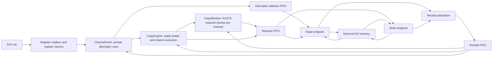

# Linear Copy, Fence and Trap RTL slice

Detailed implemented [microarchitecture](microarchitecture.md) and current
[performance measurements](performance.md) supplement this scope summary.

This DMA-core slice implements one shared engine for Linear Copy, Fence and Trap with an
instance-configured channel count in 1..8. Its independent bus widths and resource
capacities are described in [elaboration configuration](configuration.md), including
the qualification limits. Other command families remain outside this slice.
The default profile connects a 32-bit AXI4-Lite slave, a 64-bit ordinary memory
master and three asynchronous clock domains. Atomic capability is disabled and AWATOP is zero.
ARUSER/AWUSER are 35 bits: channel in bits 34:32 and the full context selector in
bits 31:0; Function/PASID translation remains outside DMA.

## Hardware and ownership



Each channel reserves space for its published 96-byte descriptors. The engine accepts a ready head once. Copy owns its
configured retained window until that command completes, stops or is reset. Each
chunk is at most `memory_bytes * burst_beats`, is bounded by both address ranges
and does not cross 4KiB. In the default profile, aligned ranges use up to eight
64-bit beats; unmatched alignment and short tails
still use byte accesses without over-reading. Source and destination selectors
remain independent. No successor in the same channel may bypass its accepted command. A safely parked
channel yields shared execution to an eligible peer.

| Owner | State and release boundary |
| --- | --- |
| `CopyEngine` | One descriptor/lifecycle context per channel, one round-robin selected shared decode/Fence/error-publication datapath |
| `CopyWindow` | `SLOTS` source/destination/length entries per channel, access states and retained read bytes; reuses a slot only after successful write and in-order retirement |
| Core RAM/read offer | `channels * slots` rows of `memory_bits * burst_beats` shared 1R1W storage, one synchronous read and one write port; a separate register holds the prepared write under backpressure |
| Request/receipt FIFOs | Independently configured depths, registered Gray pointers and two-stage synchronization; enqueue transfers custody, not transaction completion |
| Read endpoint | Configured AR tracking capacity, interleaved R-burst assembly and a held receipt |
| Write endpoint | Separately advancing AW, W and B queues; admission reserves all three, and B consumes the oldest AW/W responsibility for its BID |

Slot zero identifies the channel prefetch, slots 1..SLOTS identify retained Copy rows and SLOTS+1 identifies Fence/event writes. The bus sees separate fetch and execution IDs per channel. Each ID keeps issue order, with independent cross-ID responses and beat-interleaved reads. A fair registered R/B merger feeds the receipt FIFO.

The registered request FIFO, independent bus lanes and retained core window allow
reads and writes of different chunks to overlap. A successful read can forward
directly into available write credit while also saving its bytes for possible
retry. A blocked handoff falls back to retained RAM. A successful head write
receipt retires its slot at that edge; allocation may reuse it then, with the new
request visible next cycle. Neither path waits for unrelated software work.
The generic RAM provider does not
guarantee its output while disabled: the write-offer register explicitly captures
a valid synchronous read result. RAM array syntax does not promise a hard macro.
Synthesis defaults to an explicit [RAM boundary budget](memory-budget.md) for the
Copy buffer, with real SRAM area and intrinsic timing excluded. Generic mode maps
that array to standard cells; FIFO storage remains synthesized in both modes.

## Fault, error and reset

A successful read remains owned until its write succeeds. A recoverable payload
PageFault stops new issue, drains all accepted requests and preserves every slot's
result and needed data. `faulted` is published only after a safe park. Resume retries
failed/unissued accesses without replaying successful writes, and finishes the
retained window before allocating beyond it. A write fault never forces a reread
of source bytes that software may have changed during repair.

A permanent error closes new issue immediately. Its `bytes_completed` snapshot is
the continuous successful write prefix known when the error is recognized, not a
promise that later bytes were untouched. Later receipts do not change it. Error
publication waits for this profile's outstanding accesses to drain; software must
still use reset for recovery and resource reuse. See the
[architectural contract](../../model/modeling/docs/copy-engine.md#error-records-reporting-and-discovery).

Fence32/64 writes an aligned marker with its own context after prior work retires.
It preserves adjacent lanes and supports retained write-fault recovery. Successful
commands produce no event. A Trap following the Fence executes after the Fence write
response. It sets its channel's sticky cause and requests an interrupt if enabled
and unmasked. Software can ACK the cause independently of notification delivery.
Other opcodes and SG endpoints report Unsupported in
this slice. A stopping error writes the 24-byte event, splitting at 4KiB when needed;
producer advances only after the whole record succeeds. Reporting failure is fatal.
Each channel and the DMA-wide fatal source drive independent active-high IRQ
lines. Enable/unmask immediately exposes a live cause. The channel masks and
independent global-fatal enable have no effect on each other.

Software reset closes admission at core acceptance. It does not reset the FIFOs,
RAM or endpoint. Every accepted internal request, including queued requests not yet
accepted by AXI, must yield its terminal receipt. AW/W obligations cannot be
withdrawn; completing W alone is insufficient. A channel's clear waits for its own debt, then
invalidates only its retained state. Global reset collects every channel's clear
before completion; it never repeatedly restarts an already-cleared channel. Physical cold reset must assert across all three domains
and release synchronously in each; independent hot domain reset is unsupported.

## Verification and limits

From `rtl`, run the pinned native tools:

```sh
VERYL_DUT_REUSE=0 bash ../tools/rtl-flow/veryl.sh test
VERYL_DUT_REUSE=0 bash ../tools/rtl-flow/veryl.sh test --backend cranelift
bash ../tools/rtl-flow/veryl.sh build
```

The native DMA tests cover register access, word lanes, command ordering,
three-domain copying, W-before-AW/reset, retained faults and event publication.
`MemoryStreamTest` requires continuous W beats with multiple requests accepted
before any B return. `CopyWindowTest` checks a three-burst fault, an immutable
error-prefix snapshot despite a later success, and reset waiting for the last of
multiple receipts. Ten common-cell tests cover slices, RAMs, selection, mailbox
startup and FIFO capacity/wrap/stalls/continuous drain. `CopyWindowReuseTest` pins
head-slot retirement/reallocation at terminal receipt, without two idle state transitions.
`CopyWindowForwardTest` checks simultaneous read completion/write acceptance and
reset retaining the newly forwarded write's responsibility.
The multichannel fixtures additionally check eight retained faulted owners/peer
progress and an idle reset while a different disabled owner retains metadata debt.
Native clock advancement is not a metastability or MTBF proof.

[System verification](../../verification/dma/README.md) supplies actual AXI VIP,
independent task data/Fence oracles and passive throughput measurements. The
[throughput review](throughput-review.md) records zero-delay steady-state and full
command latency separately, plus CDC/RDC and mapped implementation evidence.
Long aligned copies now sustain the external 8B/bus-cycle rate in the qualified
profiles. Short-command startup/retirement cost and the unoptimized byte-access
path remain visible; this is not throughput closure for all alignments/configurations.

Reproducible flow code and constraints are tracked; deployment, proprietary inputs
and raw reports stay private. Mapped setup and structural CDC/RDC review do not
close routed timing, reset recovery/removal, MTBF or workload power. Review resource
ownership and the measured storage cost before expanding channels or command families.
