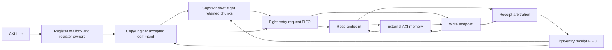

# Linear Copy and Fence RTL slice

This is the fixed one-channel DMA-core profile, not the complete configurable DMA.
It connects a 32-bit AXI4-Lite slave, a 64-bit ordinary memory master and three
asynchronous clock domains. Atomic capability is disabled and AWATOP is zero.
ARUSER/AWUSER carry the context selector; Function/PASID translation remains outside DMA.

## Hardware and ownership



The core fetches and accepts the current 96-byte descriptor once. Copy owns an
eight-slot window until that command completes, stops or is reset. Each chunk is
at most 64 bytes, is bounded by both address ranges and does not cross 4KiB.
Aligned ranges use up to eight 64-bit beats; unmatched alignment and short tails
still use byte accesses without over-reading. Source and destination selectors
remain independent. No next command may bypass the current accepted command.

| Owner | State and release boundary |
| --- | --- |
| `CopyEngine` | Descriptor, Fetch/Fence/error-publication state and channel lifecycle; changes command only after completion or reset |
| `CopyWindow` | Eight source/destination/length entries, access states and retained read bytes; reuses a slot only after successful write and in-order retirement |
| Core RAM/read offer | 8 × 512-bit 1R1W storage, one synchronous read and one write port; a separate register holds the prepared write under backpressure |
| Request/receipt FIFOs | Eight typed entries each, registered Gray pointers and two-stage synchronization; enqueue transfers custody, not transaction completion |
| Read endpoint | Up to eight accepted AR metadata entries, one ordered R-burst assembly and a held receipt |
| Write endpoint | Separately advancing AW, W and B queues; admission reserves all three, and B consumes the oldest completed AW/W responsibility |

Internal slot identities accompany requests and receipts; slot zero belongs to
serialized Fetch/Fence/event accesses and slots 1..8 to the Copy window. They are
not architectural context IDs. External reads use AXI ID zero, as do external
writes. AXI's ordering within each direction supplies receipt association; R and B
may complete independently. A fair registered merger feeds the receipt FIFO.
The request FIFO is shared: its head may backpressure later work when the selected
AXI direction stalls. This profile does not claim independent ingress queues or
out-of-order external response support.

The registered request FIFO, independent bus lanes and retained core window allow
reads and writes of different chunks to overlap. A successful read can forward
directly into available write credit while also saving its bytes for possible
retry. A blocked handoff falls back to retained RAM. A successful head write
receipt retires its slot at that edge; allocation may reuse it then, with the new
request visible next cycle. Neither path waits for unrelated software work.
The generic RAM provider does not
guarantee its output while disabled: the write-offer register explicitly captures
a valid synchronous read result. RAM array syntax does not promise a hard macro;
the current implementation assessment maps the generic storage to cells.

## Fault, error and reset

A successful read remains owned until its write succeeds. A recoverable payload
PageFault stops new issue, drains all accepted requests and preserves every slot's
result and needed data. `faulted` is published only after a safe park. Resume retries
failed/unissued accesses without replaying successful writes, and finishes the
retained window before allocating beyond it. A write fault never forces a reread
of source bytes that software may have changed during repair.

A permanent error closes new issue immediately. Its `bytes_completed` snapshot is
the continuous successful write prefix known when the error is recognized, not a
promise that later bytes were untouched. Later receipts do not change it. Error
publication waits for this profile's outstanding accesses to drain; software must
still use reset for recovery and resource reuse. See the
[architectural contract](../../model/modeling/docs/copy-engine.md#error-records-reporting-and-discovery).

Fence32/64 writes an aligned marker with its own context after prior work retires.
It preserves adjacent lanes and supports retained write-fault recovery. Successful
commands produce no event. Other opcodes and SG endpoints report Unsupported in
this slice. A stopping error writes the 24-byte event, splitting at 4KiB when needed;
producer advances only after the whole record succeeds. Reporting failure is fatal.
Notifications retain pending/accept ownership and masks do not replay old causes.

Software reset closes admission at core acceptance. It does not reset the FIFOs,
RAM or endpoint. Every accepted internal request, including queued requests not yet
accepted by AXI, must yield its terminal receipt. AW/W obligations cannot be
withdrawn; completing W alone is insufficient. Clear waits for all debt, then
invalidates retained state. Physical cold reset must assert across all three domains
and release synchronously in each; independent hot domain reset is unsupported.

## Verification and limits

From `rtl`, run the pinned native tools:

```sh
VERYL_DUT_REUSE=0 bash ../tools/rtl-flow/veryl.sh test
VERYL_DUT_REUSE=0 bash ../tools/rtl-flow/veryl.sh test --backend cranelift
bash ../tools/rtl-flow/veryl.sh build
```

The seventeen DMA tests cover register access, word lanes, command ordering,
three-domain copying, W-before-AW/reset, retained faults and event publication.
`MemoryStreamTest` requires continuous W beats with multiple requests accepted
before any B return. `CopyWindowTest` checks a three-burst fault, an immutable
error-prefix snapshot despite a later success, and reset waiting for the last of
multiple receipts. Ten common-cell tests cover slices, RAMs, selection, mailbox
startup and FIFO capacity/wrap/stalls/continuous drain. `CopyWindowReuseTest` pins
head-slot retirement/reallocation at terminal receipt, without two idle state transitions.
`CopyWindowForwardTest` checks simultaneous read completion/write acceptance and
reset retaining the newly forwarded write's responsibility.
Native clock advancement is not a metastability or MTBF proof.

[System verification](../../verification/dma/README.md) supplies actual AXI VIP,
independent task data/Fence oracles and passive throughput measurements. The
[throughput review](throughput-review.md) records zero-delay steady-state and full
command latency separately, plus CDC/RDC and mapped implementation evidence.
Long aligned copies now sustain the external 8B/bus-cycle rate in the qualified
profiles. Short-command startup/retirement cost and the unoptimized byte-access
path remain visible; this is not throughput closure for all alignments/configurations.

Reproducible flow code and constraints are tracked; deployment, proprietary inputs
and raw reports stay private. Mapped setup and structural CDC/RDC review do not
close routed timing, reset recovery/removal, MTBF or workload power. Review resource
ownership and the measured storage cost before expanding channels or command families.
