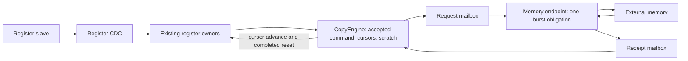

# Minimal Linear Copy RTL slice

This slice makes the design, native verification and implementation assessment
runnable before expanding to the complete DMA. It is a fixed representative
configuration, not a product configuration matrix or a full DMA implementation.

## Hardware and ownership

`DmaCopy` connects one channel, a 32-bit AXI4-Lite register slave, and a 64-bit
memory master in three domains. The memory profile uses ordinary AXI5 reads and
writes with AWATOP zero; the shared AXI4 signals use the standard typed interface.
Atomic capabilities are disabled. ARUSER/AWUSER carry the full context selector;
there is one physical channel (zero), and no Function/PASID translation in DMA.



The command ring retains the current 96-byte wire format. The core fetches the
descriptor, accepts it once, then retains its state across all payload chunks.
Each access has at most eight 64-bit beats and never crosses 4KiB. Aligned ranges
use bursts; unmatched alignment and tails use byte accesses without over-reading.
Source and destination selectors remain independent. Successful commands produce
no event. Other valid opcodes and SG endpoints report Unsupported in this slice;
they are not implemented by an alternative software path.

The bus endpoint captures a complete request before driving AR or independent
AW/W. Register ingress storage uses common-cell slices; both clock crossings
share the typed `common_cell::DuplexMailbox`. Protocol credit and drain remain
with their respective DMA owners.
The endpoint retains the slot until all required returns and receipt handoff. The
core retains successfully read bytes through a failed destination write. Payload
PageFault parks work until Resume; permanent errors stop before event publication.
The error-event producer advances only after the entire 24-byte record is written,
including a split at a 4KiB boundary. Publication failure latches channel fatal.
Notifications use pending/accept, with no replay when masks are enabled later.

Software reset closes admission in the core. It does not reset either CDC mailbox
or the bus endpoint. An accepted access may complete during closing, including
an AW still backpressured after W has completed. The core discards the returned
result instead of issuing another payload access; register clear follows receipt
consumption. Consequently reset busy cannot clear merely because the final W beat
was sent. Physical reset must assert across all three domains and release
synchronously to each clock at the integration boundary; arbitrary independent
hot reset of one domain is unsupported.

## Verification entry points

Run the native checks from `rtl` using the pinned launcher:

```sh
VERYL_DUT_REUSE=0 bash ../tools/rtl-flow/veryl.sh test
VERYL_DUT_REUSE=0 bash ../tools/rtl-flow/veryl.sh test --backend cranelift
bash ../tools/rtl-flow/veryl.sh build
```

`CopyEngineTest` drives actual configuration MMIO and memory handshakes. It checks
an aligned copy, independent AW/W backpressure, reset while AW is offered, delayed
B completion, and a new unaligned copy after reconfiguration. It runs with and
without artificial memory backpressure, covers channel and DMA-wide reset, and
reports bus cycles between payload burst completions. `CopyErrorTest` checks a stopping error and
event publication across 4KiB. `CopyFaultTest` checks write-fault suspension and
retained read data. The original register tests remain regression coverage.

The test memory is an external slave and an independent byte oracle, not a second
DMA implementation. Native clocks are advanced explicitly; this is digital CDC
handshake testing, not metastability, arbitrary clock-ratio or RDC signoff.

## Interpretation and next review

This baseline serializes read and write bursts and uses acknowledged mailboxes.
It exposes their round-trip cost deliberately: it does **not** satisfy the final
no-unreasonable-throughput-loss objective. The measured interval must be compared
with the external port capacity, not declared to be the engine's target throughput.
Unaligned byte transfers are also a functional baseline, not an optimized datapath.

Implementation assessments use the emitted hardware, excluding test modules,
and bind source, compiler, constraints and library identities to each result.
Commercial flow scripts and reports remain outside the repository. A mapped
pre-layout estimate does not prove physical CDC/RDC closure or post-route timing;
power based on synthetic activity is not workload power.

Review this complete loop before adding channels, outstanding windows or more
opcodes. Priorities for that review are resource ownership, reset obligations,
the cost of retained state and CDC, and the measured sources of throughput loss.
