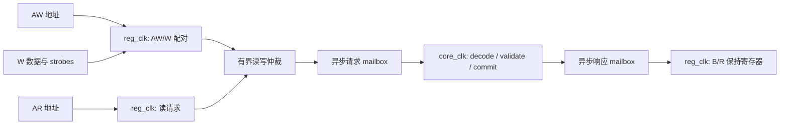

# 寄存器接口设计草案

状态：2026-10-29，DMA 寄存器访问切片已实现，见下方实施状态。Rust model、wire
contract 和 C 头文件未因总线适配改变。体系结构行为以
[系统规范](../../model/modeling/docs/spec.md) 和现有 schema 为准；数据执行、IRQ、
reset 排空及其并发优先级尚需后续 owner 实现验证。

## 实施状态

已实现 32/64 位单 leaf 访问矩阵、独立 AW/W 缓冲、B/R 保持、reg/core 跨域及
channel/ring 所属寄存器。布局由 contract 导出，未另写地址表。
具体接口约束见 [DMA RTL](../../rtl/src/dma/README.md)，覆盖见
[native tests](../../rtl/src/tests/README.md)。

跨域首版使用标准库双向 acknowledged mailbox，每方向容量为一；前端最多保留
一个未完成读和一个未完成写，core 访问串行。read/write 类别由前端保留，不在
response 中重复携带。FIFO 是原设计候选，现实现选择下图的 mailbox；尚未承诺
每拍 producer 更新带宽。生命周期状态来自外部 owner，reset 动作只产生请求，
清理完成由独立 clear 输入表明。完整 DMA reset、IRQ 竞争、AXI5 outstanding
排空和物理 CDC/RDC 并未因此得到验证。

## 目标与现状

用户已确认 AXI4-Lite 数据位宽为实例参数 32/64，寄存器前端、core、内存 master
分属三个时钟域，均异步复位、相对本域时钟同步释放。两种总线位宽共用寄存器布局、
权限与动作语义。平台决定基址；DMA 不接管外围 Function/context 的管理职责。

2026-10-29 范围收紧为 DMA-only：本阶段只实现 DmaRegisters 中 discovery、admin
和 channel blocks。外围 context table、window、boot 和 PF control/doorbell 不实现，
其寄存器改版不构成 DMA 的前置任务。

当前访问边界是一个完整 schema leaf，而不是任意地址范围：

| 类别 | 现有对象 | 生效边界 |
| --- | --- | --- |
| 32 位状态 | discovery、fatal、fault_status、IRQ cause | 所属对象读取时采样；当前没有读清寄存器 |
| 32 位普通写入 | ring capacity/cursors、ring_context、IRQ enable/mask | 先检查访问属性、合法值和当前状态，再提交 |
| 32 位发布 | channel enable | 检查完整配置后使其可用 |
| 32 位动作 | reset、resume、trap_ack | 一次有效写触发一次动作，写零行为按各 leaf 定义 |
| 64 位配置 | command/event base | 使用前配置，首次 enable 后冻结 |

DMA map 没有必须一次写入的 64 位动作；这使本阶段不需要新增分段命令提交协议。

依据：[register primitives](../../model/modeling/crates/contract/src/register.rs)、
[DMA registers](../../model/modeling/crates/contract/src/dma/registers.rs)、
[channel registers](../../model/modeling/crates/contract/src/dma/registers/channel.rs)。
通用 [RegisterWindow](../../model/modeling/crates/hw-model-schema/src/register/window.rs)
目前要求精确 leaf 起始地址和完整宽度，不能直接用它证明半字访问或 WSTRB 已受支持。

## 建议一：保留“一次访问一个 leaf”

AXI4-Lite 没有 ARSIZE/AWSIZE，读传输宽度是总线宽度；写端有 WSTRB，寄存器外设可
拒绝不支持的 strobe 组合。不能由一次 64 位 AR 推断调用者原本执行了 read32 还是
read64。依据：[Arm IHI0022H，B1.1–B1.3](https://developer.arm.com/-/media/Arm%20Developer%20Community/PDF/IHI0022H_amba_axi_protocol_spec.pdf)。

建议明确采用 **PDMA 的按地址选择 leaf 的 CSR 访问约定**：AXI beat 的容器宽度不改变
被访问对象。读返回被选 leaf 对应的有效字节，其他 lane 返回零；不顺便读取邻居。
这不是 AXI 标准替我们定义的语义，也不承诺跨两个 32 位寄存器的 64 位合并访问。

设 D 为总线字节数，lane = address mod D；所有软件访问至少 4 字节对齐。
平台地址和 aperture 基址要保留这些低地址位，64 位 leaf 保持 8 字节对齐。

| 目标/访问地址 | AXI4-Lite 32 | AXI4-Lite 64 |
| --- | --- | --- |
| 32 位 leaf 的起始地址 | 读返回 32 位；写要求 WSTRB=0xF | lane=0/4，读只填对应 32 位 lane；写要求 0x0F/0xF0 |
| 64 位配置 leaf 起始地址 A | 读/写低 32 位，WSTRB=0xF | 读返回完整 64 位；写支持 0xFF 完整值或 0x0F 低半字 |
| 同一 64 位配置 leaf 的 A+4 | 读/写高 32 位，WSTRB=0xF | 读只填高 32 位 lane；写要求 0xF0 |
| WSTRB=0 | 地址合法时成功空操作，不修改 leaf 或触发动作 | 相同 |

其他非零 strobe（单字节、半字、不连续、越过被选 leaf）返回 SLVERR。未选中的
WDATA 字节完全不参与检查。禁止把 0xFF 写拆成两个独立的 32 位动作再逐个提交。
零 strobe 仍检查地址对齐、aperture/leaf 命中，但不尝试修改 RO
值或执行动作，也不因维护 Pending 拒绝这个空操作。32 位 leaf 上的 0xFF 写必须
在任何副作用之前拒绝。写保留位沿用现有值合法性检查，
不能悄悄将非法写入吞掉。

例如当前 channel 的 command.capacity=0x08、producer=0x0C：64 位接口读 0x08
只返回 capacity，读 0x0C 在高 lane 返回 producer；写 producer 用地址 0x0C、
WSTRB=0xF0。event.producer=0x24 为 RO、consumer=0x28 为 RW。fault_status=0x38
后紧邻 WO resume=0x3C；读 fault_status 不访问 resume。保留紧凑布局而不引入
相邻 leaf 之间的读权限和副作用耦合。偏移均相对 ChannelBlock，源自当前生成布局。

**平台约束。** 桥接器必须保留被选寄存器地址（尤其 bit 2）和 byte lane 含义，
不能把请求向下对齐后合并邻居，或擅自扩成对两个 leaf 的访问。普通 64 位内存加载
不等于“获取相邻两个寄存器”。若集成平台要求完全按 beat 覆盖范围访问，则必须另行
评审布局/访问合同；不能宣称本方案无条件兼容所有宽度转换器。选此方案的动机是保持
现有单 leaf 语义，避免为每个 32 位寄存器浪费一个 8 字节槽或引入跨 leaf 事务回滚。

## 建议二：配置值可以拆，动作不拆

64 位配置每次半字写直接更新所属对象的配置存储，不增加一份通用 shadow。
硬件只在 channel enable 发布之后使用完整值，已发布值按原合同冻结。软件应先写低字，
再写高字，确认写入完成后发布；硬件不依赖该顺序，不维护“低字已到达”状态。
一位软件所有者负责串行配置，同步释放 reset 不是软件配置完成的替代标志。

半字更新必须在 core 中基于同一个 leaf 的当前值形成候选完整值、验证并提交。
不能在 reg 域先读旧值，跨域后再以旧快照覆盖另一半。32/64 位总线采用相同权限、
配置锁定和错误规则；拆写中断只留下未发布配置，不得导致 DMA 使用半个地址。
若配置中途 reset，软件重做完整配置，不能继续提交另一半并假定此前的值仍存在。

两次 32 位读取不提供 64 位原子快照保证。当前 64 位配置不由硬件自增；软件必须排除
并发配置/reset，或在冻结配置期间读取。不为未来尚不存在的活动计数器增加快照硬件。

DMA 的 reset/resume/trap_ack 都要求完整 32 位 lane；成功写只表示请求按相应语义
被接受，不把 reset 的 B 返回当作排空完成。动作的读属性、自清零或 busy 保持由
原 leaf 合同决定，不能强行归成一种通用“写后清零”寄存器。

## 前端、跨域与真实寄存器的分工

前端不镜像硬件寄存器。建议内部 request 携带 op、原始 byte address、64 位数据容器、
byte enable 和静态端口位宽信息；response 携带 read/write 类别、
结果和读数据。core 根据 layout 确定 leaf，外部软件不能伪造 leaf ID 或权限标志。
无须增加软件可见 transaction ID，也不让 generic schema 依赖 AXI。

本阶段 DMA 接收外部已允许的寄存器访问，检查 leaf 的 RO/WO、保留位及生命周期。
它不识别 Function/PF/VF，不从 AXPROT 推导 firmware 身份。未来窗口授权在外围做，
不能通过把 Function 表加入 DMA 来“提前兼容”managed 模式。AXI4-Lite 的 AW/W
仍独立配对，不要求它们同拍，也不把某条 W 自动配给最近到达的另一个 AW。

首版控制端口建议每入口最多一个未完成读和一个未完成写；AW/W 各有独立保持位，
支持 W 先到、AW 先到和同拍到。读请求不会等待一个缺失 W 的 AW。完整写与读都就绪
时公平仲裁送往跨域请求通路。核心提交顺序由入口仲裁和请求交付顺序确定；读写跨方向不凭
AXI 握手时间臆造全序。软件要求“写后读”时，应先等待 B，再发 AR。

当前跨域使用单项请求/回复握手，reg 域另外保留 AW/W/AR 与 B/R 的独立存储；不把
它描述成已实现多项异步 FIFO。低频配置/状态访问采用完整请求—响应跨域是成熟做法，
例如 [PULP reg_cdc](https://github.com/pulp-platform/register_interface/blob/master/src/reg_cdc.sv)
也分别用两向握手传输请求与响应。若 doorbell/MMIO 的目标请求率需要连续入队，再按
并发容量和返回保管义务评估 FIFO 方案；不因存在结构汇聚报告就更换协议。
返回方向必须保证每个已接收请求都有响应存储位置：B/R 各有保持寄存器，背压时数据
稳定，不重复触发动作。限制下一笔同类事务的接收，可避免某个 BREADY=0 反复占用
所有响应空间。有限 MMIO 带宽与 payload 持续吞吐是不同预算；不能把这个简化方案
冒称支持每拍 producer 更新，需在小 command 场景测量后决定是否加深队列。

core 的本地操作在一个明确的接受点完成检查与提交。只有 committed/rejected 结果
形成后才产生 B；不能在 CDC 入队时就回 OKAY。读在 core 获取快照，RREADY 延迟不
改变快照或重复读副作用。软件 reset 请求只设置/推进清理，绝不等 reset 完成才回 B，
因此执行流水或内存端口长期阻塞不应阻止读取 busy 或发出恢复请求。

## 权限、错误和并发边界

| 情况 | 建议总线响应 | 状态变化 |
| --- | --- | --- |
| 成功读写 | OKAY | 按所属 leaf 语义恰好执行一次 |
| 不属于任何 aperture，或命中布局保留空洞 | DECERR | 无 |
| 对齐/strobe/编码非法、RO 写、WO 读、权限不足 | SLVERR | 无；错误读 RDATA=0 |
| 配置被冻结、scope resetting、维护互锁禁止本次修改 | SLVERR | 无，不清旧结果 |

上表是 PDMA 的错误映射建议，不是 AXI 强制规定所有业务错误的编码。寄存器访问失败
不产生 DMA command event，不触发 payload page-fault resume 协议。AXI5 内存端的
RESP+USER 故障原因与此控制接口分开定义。所有预检在动作之前执行，不能先触发
reset/resume 再发现 strobe 或访问属性非法。

DMA 的访问属性、配置锁和 reset 状态在 **core 实际执行时** 检查，不能只在 reg 域
缓存“channel 可写”。未来 managed 窗口须另做执行点授权，不能因某 channel 打开
就放行 admin；这部分外围实现和多来源系统仲裁不属于本阶段。

同拍优先级建议：先决定 reset/fatal 关闭边界，再检查本拍能否提交普通配置和发出新
工作；已经承诺的 bus 义务照常退休。读取得操作点的状态，不承诺看到同拍稍后发生的
完成。对 sticky cause 的软件清除和新硬件置位采用置位优先；未 faulted 时的 resume
不能预先清掉同拍新 fault。具体数据通路与 context frontier 的边界需在后续设计中
统一，不允许仅用一个全局 reset 信号删除尚未完成的工作。

异步物理复位使前端停止握手，并按三个域的初始化协议恢复；不能将复位中消失的 B/R
伪造成成功。软件 reset 不复位 AXI 前端/CDC 队列。scope reset 完成只证明约定的
数据工作清理，不能自动取消尚未送达 core 的外部 MMIO；软件在 release/rebind 前须
停止旧访问并等已发 MMIO 完成。软件取消 future 也不撤销已接受的总线写。

## 软件顺序示例

配置 channel 时先在 reset 完成后写 base 的低/高字、capacity、ring_context 和通知
配置；在内存中准备 descriptor，执行平台要求的可见性操作，再发布 producer/enable。
enable 成功后配置冻结。等待 B 是寄存器接受证明，**不是普通内存 cache clean 或
DMA 可见性屏障**。相关平台 cache/ordering 义务保持不变。

## 实施映射与验收

评审后依次推进，先有失败行为测试再改实现，不以文档表格代替运行证据：

1. 以现有 DMA schema 为布局来源，核对 32/64 位访问矩阵；本阶段不改外围 ContextRequest。
2. RTL 控制前端及各 DMA owner：实现 lane/strobe、配置半字合并和 CDC 接受/返回；
   testbench 驱动实际 AXI 访问，软件总线适配将 typed 64 位配置访问展开。
   schema 的完整 leaf API 保持原意，不为 AXI 增加通用读改写软件锁。
3. 用独立 bus 测试验证本文件的 transport 行为；Rust model 只验证已有体系结构语义及
   经批准的 contract 改动，不向 step 模型塞 AXI 时序或周期仿真。

| 场景 | 必须观察的结果 |
| --- | --- |
| 两种端口位宽、32 位 leaf 两种 lane、64 位配置全字/半字 | 读回正确，未选 lane 为零，未选 leaf 不被访问 |
| 读 fault_status 紧邻 resume | 不触发邻居，显式 WO 读仍报错 |
| 零/非法 strobe、保留位、未对齐 | 拒绝无副作用；零 strobe 不发请求或清历史结果 |
| base 两次写之间 enable/reset、冻结后改 base | 不使用未发布配置；配置锁定不被半字更新绕过 |
| W 先到、AW 先到、B/R 长背压、同时读写 | 正确配对、恰好一次提交、响应稳定、另一类请求有界推进 |
| reset 发生于前端接收后/core 执行前 | 在执行点按最新生命周期状态处理 |
| 任意时钟相位/比值、不同域释放先后 | 初始化前不传递伪请求，跨域数据完整，不重复副作用 |
| reset 请求后立刻读 busy，数据访问长 outstanding | 请求响应可返回，busy 只有真实 cleanup 后才清零 |
| 普通配置/发布和 hardware 状态更新同拍 | 匹配明确优先级，不丢新 fault/Trap，不产生半配置 |

## 当前草案选择与边界

本稿按单 leaf 的 64 位总线访问约定及其桥接限制继续展开 DMA 设计。
访问适配已落到真实 AXI 端口的 native 测试，未改变已有 ABI；尚未实现的并发与
生命周期约束仍是后续设计要求。内存事务和责任排空分别见 [memory-interface](memory-interface.md)
与 [reset-cdc](reset-cdc.md)，不要求用户逐项设计握手状态机。

## 外围阶段待办，不阻塞 DMA

外围 ContextRequest 目前完整 64 位写的合同不能直接用于 32 位 AXI4-Lite。此前提出的
30 位 index + 2 位 action 是一种候选，**未被实现或冻结**；对应容量限制也不是 DMA
的规格。外围阶段再连同 context table、window 权限、control bootstrap/doorbell 和
firmware 软件路径整体审查。当前 DMA selector 和内部维护请求保持完整 ContextId。
